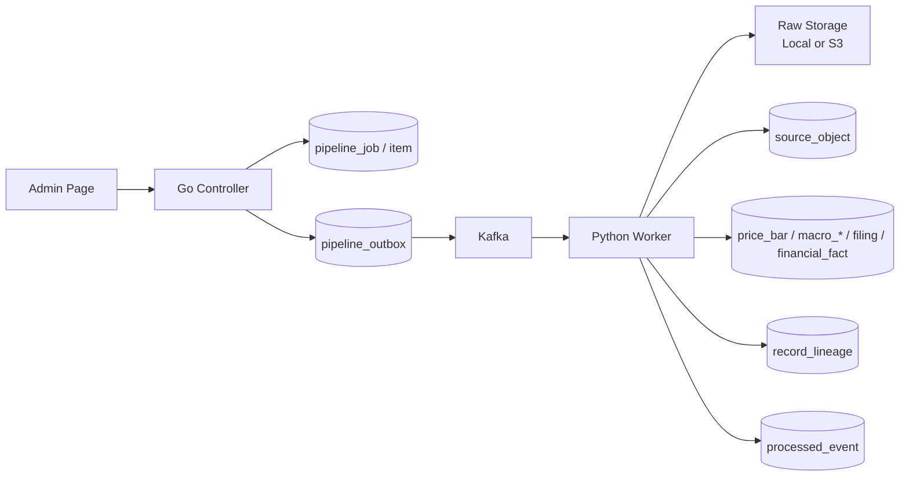

# Trader Data Platform 문서 인덱스

> 목적: SEC, BLS, KIS 데이터를 수집하고 raw 보존, Kafka outbox, lineage, worker 제어를 통해 재처리 가능한 데이터 파이프라인을 구축한 내용을 면접/포트폴리오용으로 빠르게 설명한다.

---

## 1. 30초 요약

Trader Data Platform은 주가, 재무, 매크로 데이터를 외부 API에서 수집한 뒤 원본 raw를 보존하고, 정규화 테이블과 lineage를 연결하는 데이터 운영 파이프라인이다.

핵심은 미래 가격 예측 모델이 아니라 다음 운영 문제를 다루는 것이다.

- 외부 API 실패와 누락을 어떻게 추적할 것인가
- raw 원본과 정규화 레코드를 어떻게 연결할 것인가
- Kafka 장애 또는 worker 종료 시 이벤트를 어떻게 잃지 않을 것인가
- 관리자 페이지에서 job, raw, Kafka, ETL, lineage 상태를 어떻게 확인할 것인가
- 비용 절감을 위해 어떤 서버만 Spot 후보로 둘 것인가

---

## 2. 문서 구조

| 문서 | 읽는 목적 | 면접에서 연결되는 질문 |
| --- | --- | --- |
| [01_DATA_PIPELINE_ARCHITECTURE.md](./01_DATA_PIPELINE_ARCHITECTURE.md) | 전체 구조, 데이터 흐름, 주요 테이블, 설계 결정 | "왜 Kafka를 썼나요?", "Go와 Python 역할은 왜 나눴나요?" |
| [02_FAILURE_RECOVERY_SCENARIOS.md](./02_FAILURE_RECOVERY_SCENARIOS.md) | 장애 시나리오와 복구 정책 | "worker가 죽으면 어떻게 되나요?", "중복 처리는 어떻게 하나요?" |
| [03_AWS_DEPLOYMENT_COST_OPTIMIZATION.md](./03_AWS_DEPLOYMENT_COST_OPTIMIZATION.md) | AWS 배포 구성, On-Demand/Spot 분리, 비용 판단 | "왜 DB는 Spot이 아닌가요?", "비용 최적화는 어떻게 했나요?" |

관련 상세 문서:

| 문서 | 역할 |
| --- | --- |
| [DATA_SCHEMA_DESIGN.md](./DATA_SCHEMA_DESIGN.md) | 데이터 모델 원본 문서 |
| [RAW_ETL_SPLIT_STRUCTURE.md](./RAW_ETL_SPLIT_STRUCTURE.md) | collector-only / etl-only 분리 구조 |
| [PIPELINE_OPERATION_RECOVERY.md](./PIPELINE_OPERATION_RECOVERY.md) | 파이프라인 운영 및 복구 상세 |
| [KAFKA_CONSUMER_DESIGN.md](./KAFKA_CONSUMER_DESIGN.md) | Kafka consumer와 중복 처리 설계 |
| [원본_정규화_Lineage_검증_결과.md](./원본_정규화_Lineage_검증_결과.md) | raw와 정규화 레코드 연결 검증 |
| [워커_시작_종료_정책_설계.md](./워커_시작_종료_정책_설계.md) | worker scale-out/in 정책 |

---

## 3. 현재 구현 범위

| 영역 | 상태 | 설명 |
| --- | --- | --- |
| BLS 수집/ETL | 구현 및 검증 | macro series, observation, vintage, status 적재 |
| KIS 주가 수집/ETL | 구현 및 검증 | price_bar 적재, quality status, lineage 연결 |
| SEC 재무 수집/ETL | 구현 및 검증 | company, filing, financial_fact 적재 |
| Go controller/admin | 구현 | job 생성, outbox, worker control, raw data viewer |
| Kafka outbox relay | 구현 | DB outbox -> Kafka publish -> partition/offset 기록 |
| Python worker | 구현 | job consumer, source별 worker, raw ETL worker |
| Raw Data 관리자 탭 | 구현 | raw 처리 상태, Kafka 발행, consumer commit, lineage 확인 |
| Worker Control | 구현 | worker target, policy, heartbeat, scale command 확인 |
| AWS 배포 | 진행 예정 | On-Demand 기반 + Python worker Spot 후보 |
| RAG/AI 챗봇 | 후순위 | 데이터셋 조회 API와 context assembler 이후 진행 |

---

## 4. 핵심 운영 흐름



---

## 5. 면접에서 강조할 포인트

1. 데이터를 바로 DB에 넣지 않고 raw를 먼저 보존했다.
2. Kafka를 payload 저장소가 아니라 처리 이벤트 버퍼로 사용했다.
3. Kafka publish 전에 DB outbox를 먼저 기록해 Kafka 장애 시 유실을 줄였다.
4. ETL 완료 후 `processed_event`와 Kafka offset commit을 기록해 중복 처리를 제어했다.
5. raw와 정규화 결과를 `record_lineage`로 연결해 오류 추적이 가능하게 했다.
6. Python worker만 Spot 후보로 두고, DB/Kafka/controller는 안정성을 위해 On-Demand로 유지하는 판단을 했다.

---

## 6. 문서 증거 작성 원칙

포트폴리오 문서는 스크린샷을 많이 붙이기보다, 구조와 방어 전략이 빠르게 읽히도록 작성한다. 관리자 화면 캡처는 보조 증거로만 사용하고, 핵심은 다이어그램, 문제 해결 표, 짧은 코드 스니펫, SQL 검증 결과로 남긴다.

| 증거 유형 | 사용 방식 | 이유 |
| --- | --- | --- |
| 아키텍처 다이어그램 | 전체 구성과 책임 분리 설명 | 면접관이 시스템 경계를 빠르게 파악할 수 있다. |
| 플로우 다이어그램 | job, raw, outbox, Kafka, ETL, lineage 흐름 설명 | 장애가 어느 지점에서 방어되는지 보인다. |
| 문제/방어 전략 표 | 장애 가능성, 방어 방식, 남은 한계 정리 | 단순 구현보다 운영 판단을 보여준다. |
| 짧은 코드 스니펫 | outbox 선점, 중복 처리, 세션 인증 등 핵심 10~25줄 | 전체 코드보다 의사결정 지점이 잘 보인다. |
| SQL/로그 텍스트 | `PUBLISHED`, `SUCCESS`, `PROCESSED`, lineage count 등 요약 | 스크린샷 없이도 검증 결과를 재현 가능하게 남긴다. |
| 화면 캡처 | Raw Data, Kafka Monitor, Worker Control 중 2~3장만 선택 | UI가 실제로 존재함을 보여주는 보조 자료로 제한한다. |

검증 결과는 아래처럼 짧게 남긴다.

```text
pipeline_outbox: PUBLISHED, partition=2, offset=0
processed_event: SUCCESS, idempotency_key=RAW_OBJECT_READY:8755
source_object: PROCESSED, storage_key=kis_price_collector/...
record_lineage: price_bar 4 rows
```

이 방식으로 문서 크기를 줄이고, "무엇을 만들었는가"보다 "어떤 운영 문제를 방어했는가"가 먼저 보이게 한다.

---

## 7. AWS 검증 업데이트 - 2026-07-08

AWS 배포 환경에서 BLS 수동 job을 기준으로 control plane, Kafka, Python worker, raw 저장, ETL까지 이어지는 흐름을 검증했다.

검증에 사용한 item:

```text
pipeline_job_item.id=39
item_key=BLS:CES0000000001
```

최종 상태:

```text
pipeline_job_item.status=COLLECTED
source_object.id=8775
source_object.processing_status=PROCESSED
pipeline_outbox JOB_ITEM_QUEUED=PUBLISHED
pipeline_outbox RAW_OBJECT_READY=PUBLISHED
```

실제 처리 결과 요약:

```text
BLS collector:
macro_series rows=1
macro_observation rows=24
macro_observation_vintage rows=24
source_object rows=1
record_lineage rows=49

Kafka job event:
topic=trader.jobs.events
partition=0
offset=0
result=success

Raw/ETL:
source_object=8775
provider=BLS
data_type=TIMESERIES
processing_attempt_count=1
processing_started_at=2026-07-08 09:04:33+09
processing_finished_at=2026-07-08 09:04:33+09
```

운영 관점에서 확인한 포인트:

- `JOB_ITEM_QUEUED`는 수집 시작을 위한 control-plane event로 즉시 소비되어야 한다.
- `RAW_OBJECT_READY`는 source별 raw topic으로 발행되어 ETL worker가 처리한다.
- Kafka 재시작 이후 DB outbox와 Kafka topic 상태가 어긋난 경우, `pipeline_outbox`를 기준으로 재발행해 복구할 수 있다.
- `source_object.processing_status`, `processing_started_at`, `processing_finished_at`, `record_lineage`를 통해 raw부터 정규화 결과까지 추적할 수 있다.
