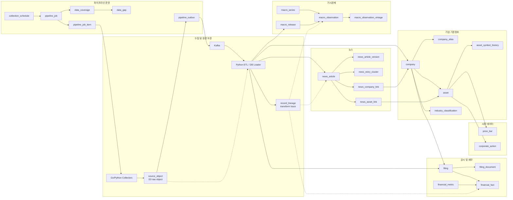
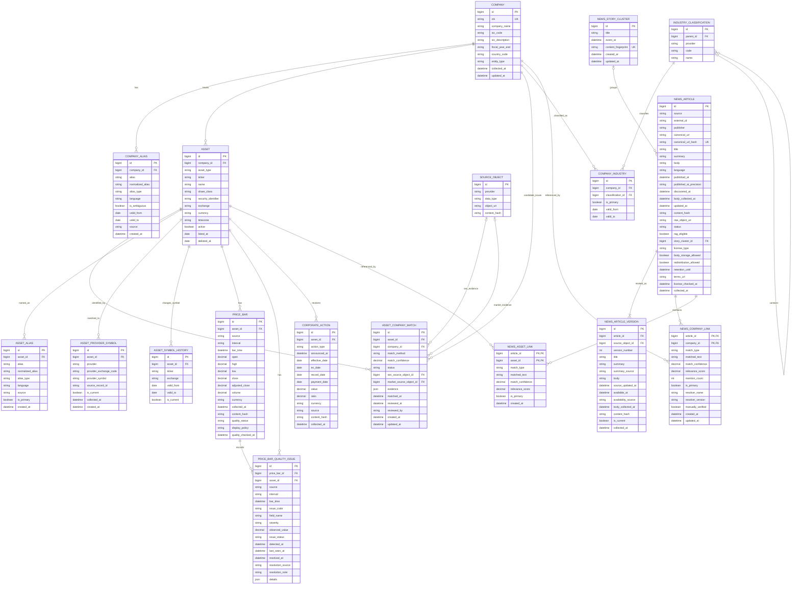
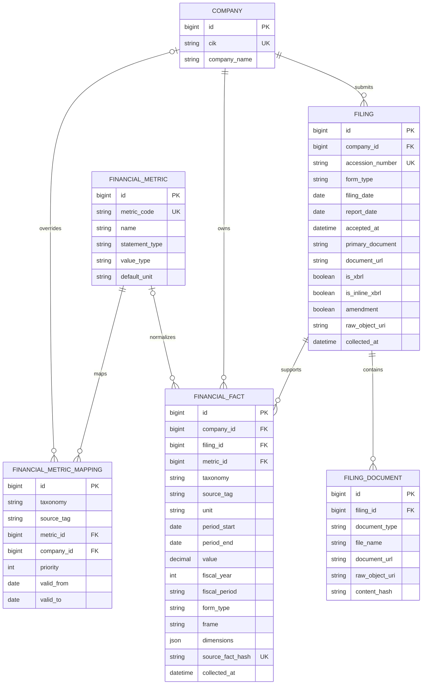
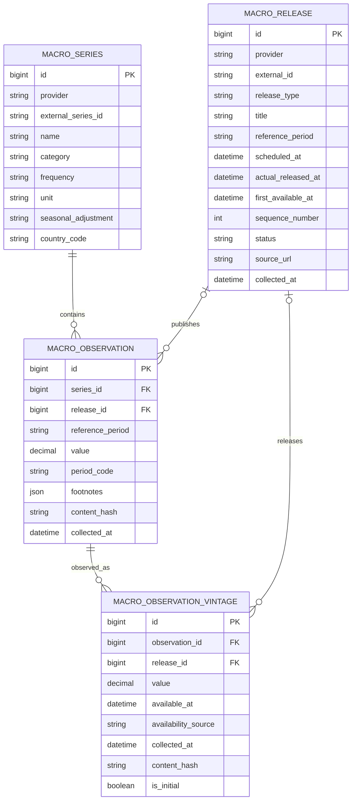
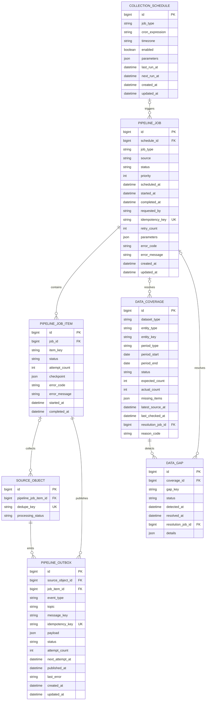
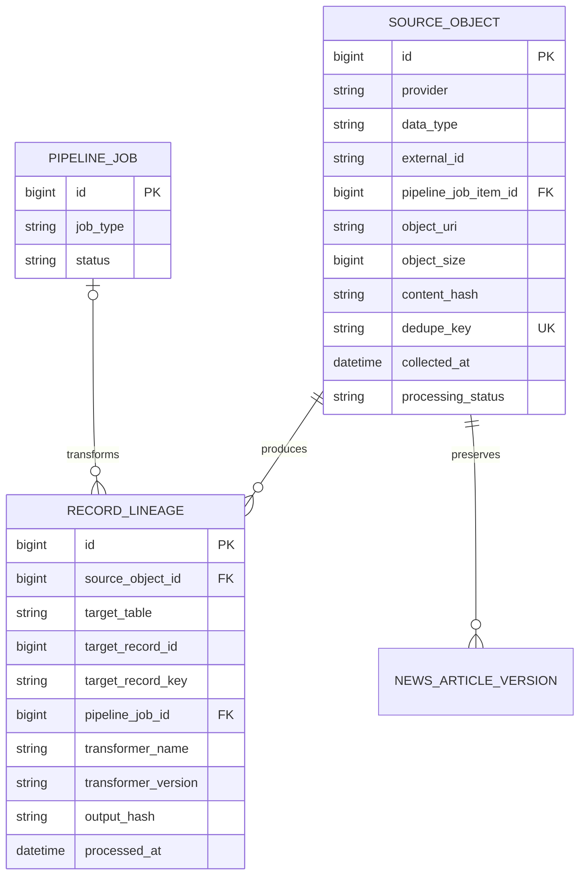

# Trader Data Schema Design

## 1. 목적

뉴스, 주가, SEC 공시·재무제표, 기업정보, BLS 매크로 데이터를 수집하고 결합하기 위한 초기 데이터 모델이다.

서비스의 주된 목적은 미래 가격 예측이 아니라 과거 시점에 공개된 정보와 이후 시장 반응을 복기하는 것이다. 따라서 다음 세 시각을 반드시 분리한다.

- `reference_period`: 데이터가 설명하는 대상 기간
- `published_at`, `accepted_at`, `actual_released_at`: 외부에 공개된 시각
- `collected_at`: 내부 수집기가 데이터를 가져온 시각

## 2. 공통 원칙

| 원칙 | 설명 |
|---|---|
| 원본 보존 | 외부 API 응답을 가공 전에 S3 또는 raw storage에 보존한다. |
| 식별자 유지 | SEC 태그, accession number, BLS Series ID를 원본 그대로 유지한다. |
| 정규화 분리 | 원본 필드와 서비스용 표준 필드를 분리한다. |
| UTC 저장 | 모든 시각은 UTC로 저장하고 화면에서 사용자 시간대로 변환한다. |
| 멱등성 | 외부 식별자와 content hash를 사용해 중복 처리를 방지한다. |
| 수정 이력 | 수정 가능한 매크로·재무 데이터는 revision을 보존한다. |
| Nullable 허용 | 외부 제공자가 보장하지 않는 값은 nullable로 둔다. |

### 공통 필드

| 필드 | 설명 |
|---|---|
| `id` | DB 내부 PK. 외부 ID가 변경돼도 테이블 관계를 유지한다. |
| `source`, `provider` | KIS, SEC, BLS 등 데이터 제공자다. |
| `external_id` | 외부 서비스가 제공한 원본 식별자다. |
| `collected_at` | 데이터를 수집한 UTC 시각이다. |
| `updated_at` | DB 레코드가 마지막으로 변경된 시각이다. |
| `content_hash` | 내용 변경과 중복을 판별하는 해시다. |
| `raw_object_uri` | 원본 JSON·HTML을 저장한 S3 위치다. |
| `status` | 수집, 처리, 실패 등 현재 상태다. |

### 파이프라인 구간별 테이블 책임

전체 파이프라인은 `작업 예약 -> 원본 수집 -> ETL 정규화 -> 기업·Asset 연결 -> Lineage 연결 -> Coverage 검증 -> 서비스 조회` 순서로 진행한다. 각 컴포넌트는 자신의 구간에 해당하는 테이블만 직접 변경하고, 다음 구간의 비즈니스 판단까지 대신 수행하지 않는다.

```text
Scheduler / Admin
  -> Collector
  -> Raw Storage + Kafka
  -> Transformer / DB Loader
  -> Company-Asset Linker
  -> Coverage Checker
  -> Service API
```

| 순서 | 구간 | 담당 컴포넌트 | 직접 확인·변경하는 테이블 | 구간 설명 |
|---:|---|---|---|---|
| 1 | 작업 예약 | Scheduler, 관리자 API | `collection_schedule`, `pipeline_job`, `pipeline_job_item` | 어떤 제공자·기업·시계열·기간을 언제 수집할지 결정하고 작업 상태를 생성한다. |
| 2 | 원본 수집 | SEC·BLS·KIS Collector | `pipeline_job_item`, `source_object`, `pipeline_outbox` | 외부 API 원본을 raw storage에 보존하고, 원본 메타데이터와 Kafka 발행 이벤트를 한 DB 트랜잭션에 저장한다. |
| 3 | 이벤트 전달 | Outbox Relay, Kafka Producer | `pipeline_outbox` | `PENDING` 이벤트를 Kafka에 발행하고 성공 시 `PUBLISHED`, 일시 실패 시 `RETRY_WAIT`로 변경한다. |
| 4 | ETL 정규화 | Python Transformer, DB Loader | 기업·주가·공시·재무·매크로 도메인 테이블 | 원본을 파싱·검증하고 자연키로 FK를 해석한 후 멱등 upsert한다. |
| 5 | 기업·Asset 연결 | Company-Asset Linker | `asset_provider_symbol`, `asset_company_match`, `asset.company_id` | SEC의 CIK·ticker·거래소와 KIS의 제공자 거래소 코드·ticker를 비교한다. 정확히 한 후보만 일치하면 확정하고 나머지는 검토 대상으로 남긴다. |
| 6 | 변환 추적 | Transformer, DB Loader | `record_lineage` | 정규화 결과가 어느 원본과 Transformer 버전에서 생성됐는지 연결한다. 정규화 행 저장과 같은 처리 단위에서 기록한다. |
| 7 | 완전성 검사 | Coverage Checker | `data_coverage`, `data_gap` | 기대 범위와 실제 적재 결과를 비교하고 누락된 기업·기간·지표를 백필 대상으로 등록한다. |
| 8 | 서비스 조회 | Backend API | 정규화 도메인 테이블을 읽기 전용으로 사용 | 차트, 뉴스, 공시, 재무, 매크로 데이터를 결합해 사용자 화면과 이후 분석 계층에 제공한다. |

#### 원본 수집 단계의 최소 책임

Collector가 직접 책임지는 핵심 테이블은 `source_object`, `pipeline_job`, `pipeline_job_item`, `pipeline_outbox`다. `collection_schedule`은 Scheduler가 관리하며 Collector는 생성된 Job을 실행한다.

```text
pipeline_job_item 확인
-> 외부 API 호출
-> 원본 파일 저장
-> DB 트랜잭션에서 source_object와 pipeline_outbox 생성
-> pipeline_job_item을 COLLECTED 또는 FAILED로 변경
-> Outbox Relay가 Kafka에 원본 참조 전달
```

예를 들어 SEC Collector는 Company Facts JSON을 S3에 저장하고 `source_object`를 생성하는 데까지 책임진다. 매출 태그를 `REVENUE`로 바꾸거나 `company_id`와 연결하는 작업은 이후 ETL 구간의 책임이다.

#### 원본별 ETL 대상 테이블

| 제공자·원본 | 원본에서 확보하는 내용 | ETL이 생성·갱신하는 테이블 | 비고 |
|---|---|---|---|
| SEC Submissions | 기업명, CIK, ticker, 거래소, 공시 목록, 과거 법인명 | `company`, `filing`, `company_alias`, `asset_provider_symbol`, `asset_company_match` | SEC는 법적 기업을 생성한다. ticker·거래소는 기존 KIS Asset을 찾기 위한 연결 근거로 사용한다. |
| SEC Company Facts | taxonomy, XBRL tag, 단위, 기간, 값, accession | `financial_fact` | 원본 tag를 보존하고 표준 지표 매핑은 별도 단계에서 수행한다. |
| SEC Filing HTML·첨부파일 | 공시 본문과 첨부문서 | `filing_document` | 원문은 raw storage에 유지하고 DB에는 위치와 hash를 저장한다. |
| BLS Release Calendar·RSS | 발표 UID, 예정시각, 실제 게시시각 | `macro_release` | 대상 기간과 발표시각을 분리한다. |
| BLS Timeseries API | Series ID, 대상 월, 값, 주석 | `macro_series`, `macro_observation`, `macro_observation_vintage` | 반복 수집에서 값이 바뀌면 Vintage를 append-only로 추가한다. |
| KIS 종목 마스터 | ticker, 제공자 거래소 코드, 통화, 한글·영문 종목명, 종목 유형 | `asset`, `asset_alias`, `asset_provider_symbol` | 종목명은 기업명이 아니라 증권명이므로 `company_alias`에 바로 넣지 않는다. ETF·지수 등은 `asset.company_id`를 nullable로 유지한다. |
| KIS 가격 API | 시가·고가·저가·종가·거래량 | `price_bar` | 기간 재조회와 멱등 upsert로 누락을 보완한다. |
| 배당·분할 제공 데이터 | 배당금, 분할비율, 적용일 | `corporate_action` | 실제 가격 변동과 기술적 조정을 구분하는 데 사용한다. |

#### ETL 이후에 보는 운영 테이블

`record_lineage`는 ETL 성공과 함께 생성하고, `data_coverage`와 `data_gap`은 정규화 데이터가 저장된 뒤 계산한다. Job이 성공했더라도 기대한 재무 분기나 매크로 월이 빠질 수 있으므로, 작업 성공과 데이터 완전성을 별도로 판단한다.

초기 구현에서 `industry_classification`, `company_industry`, `financial_metric_mapping`은 원본 수집기의 책임이 아니다. 기본 수집과 적재가 안정화된 뒤 비교 기능과 재무 표준화를 확장할 때 적용한다. 뉴스의 Entity Linking과 RAG·Embedding 테이블도 별도 후속 계층으로 둔다.

KIS와 SEC의 연결 순서는 `KIS 종목 마스터 -> Asset 생성 -> SEC Company 생성 -> ticker·거래소 후보 비교 -> Match 확정 -> asset.company_id 갱신`이다. 기존 `stock_info`와 `stock` 데이터는 Flyway에서 한 번에 옮기지 않고, 멱등 백필 Job과 Coverage 검증을 통해 단계적으로 이관한다.

## 3. 기업과 종목

기업은 SEC 공시와 재무제표를 제출하는 법적 주체이고, Asset은 시장에서 가격이 형성되는 거래 대상이다. 한 기업이 여러 주식 종류와 거래소 종목을 가질 수 있으므로 분리한다.

### 서비스 관점

| 항목 | 설명 |
|---|---|
| 해결하는 문제 | 사용자 표현, SEC 기업, 실제 거래 종목을 하나의 식별 체계로 연결한다. |
| 사용자 기능 | 기업·ticker 검색, 동종업계 비교, 기업별 뉴스·공시·주가 통합 조회에 사용한다. |
| 핵심 관계 | SEC의 `company`와 KIS의 `asset`을 각각 먼저 생성하고 `asset_company_match`에서 근거를 검증한 뒤 `asset.company_id`를 확정한다. |
| 대표 예시 | Alphabet은 하나의 기업이지만 `GOOG`, `GOOGL`처럼 여러 Asset을 발행할 수 있다. |
| 주의할 점 | ticker는 변경·재사용될 수 있으므로 기업 식별자로 직접 사용하지 않고 기간 이력을 확인한다. |

### `company`

| 필드 | 필수 | 설명 |
|---|---:|---|
| `id` | O | 내부 PK다. |
| `cik` | O | SEC 기업 고유번호다. 앞자리 0을 유지하기 위해 문자열로 저장한다. |
| `company_name` | O | SEC 기준 기업명이다. |
| `sic_code` | X | SEC 산업분류 코드다. `VARCHAR(4)`를 사용한다. |
| `sic_description` | X | SIC 산업 설명이다. |
| `fiscal_year_end` | X | 기업의 회계연도 종료 월·일이다. |
| `country_code` | X | 기업 소재 국가다. |
| `entity_type` | X | 일반 기업, 펀드 등 SEC 등록 유형이다. |
| `collected_at` | O | 기업정보 수집시각이다. |
| `updated_at` | O | 마지막 변경시각이다. |

권장 제약조건: `UNIQUE(cik)`

### `company_alias`

뉴스의 기업명·브랜드명·ticker를 내부 `company_id`와 연결하기 위한 Alias 사전이다. 정확한 문자열 매칭을 먼저 수행하고, 애매한 경우에만 NLP 또는 LLM을 사용한다.

| 필드 | 필수 | 설명 |
|---|---:|---|
| `id` | O | 내부 PK다. |
| `company_id` | O | Alias가 가리키는 기업이다. |
| `alias` | O | 원본 기업명, ticker, 브랜드명 또는 제품명이다. |
| `normalized_alias` | O | 대소문자·공백·기호를 정규화한 검색용 값이다. |
| `alias_type` | O | `LEGAL_NAME`, `NAME`, `TICKER`, `BRAND`, `PRODUCT`, `KOREAN_NAME` 등이다. |
| `language` | X | `en`, `ko` 같은 Alias 언어다. |
| `is_ambiguous` | O | `META`, `CAT`처럼 일반 단어와 혼동될 수 있는지 여부다. |
| `valid_from` | X | ticker·기업명 변경 시 Alias 유효 시작일이다. |
| `valid_to` | X | Alias 유효 종료일이다. 현재 유효하면 nullable이다. |
| `source` | O | SEC, 거래소, 관리자 등 Alias 출처다. |
| `created_at` | O | Alias 등록시각이다. |

권장 제약조건: `UNIQUE(company_id, normalized_alias, alias_type)`

### `asset`

| 필드 | 필수 | 설명 |
|---|---:|---|
| `id` | O | 가격과 매매일지가 참조할 내부 PK다. |
| `company_id` | X | 발행 기업이다. 지수·원자재·환율은 nullable이다. |
| `asset_type` | O | `COMMON_STOCK`, `ADR`, `ETF`, `INDEX`, `FUTURE`, `FOREX` 등이다. |
| `ticker` | O | 거래소 종목코드다. |
| `name` | O | 화면에 표시할 종목명이다. |
| `share_class` | X | Alphabet Class A·C처럼 동일 기업의 주식 종류를 구분한다. |
| `security_identifier` | X | ISIN, CUSIP 등 외부 증권 식별자다. |
| `exchange` | O | NASDAQ, NYSE 등 거래소다. |
| `currency` | O | 가격 통화다. |
| `timezone` | O | 거래소 시간대다. |
| `active` | O | 현재 거래 가능한지 여부다. |
| `listed_at` | X | 상장일이다. |
| `delisted_at` | X | 상장폐지일이다. |

현재 거래 가능한 ticker만 중복되지 않도록 부분 유니크 인덱스를 사용한다.

```sql
CREATE UNIQUE INDEX uq_asset_active_exchange_ticker
ON asset (exchange, ticker)
WHERE active = TRUE;
```

상장폐지된 Asset과 신규 Asset이 같은 ticker를 사용하더라도 서로 다른 행으로 저장한다. 증권 자체의 정체성은 `asset.id`, `security_identifier`, `share_class`로 구분하고 과거 ticker는 `asset_symbol_history`에서 조회한다.

### `asset_alias`

KIS 종목 마스터의 한글명·영문명처럼 기업명이 아니라 거래 증권 자체를 표현하는 이름을 저장한다. ETF, ADR, 우선주, 레버리지 상품 이름을 `company_alias`에 넣어 발행 기업과 혼동하는 문제를 방지한다.

| 필드 | 필수 | 설명 |
|---|---:|---|
| `id` | O | 내부 PK다. |
| `asset_id` | O | Alias가 가리키는 거래 종목이다. |
| `alias` | O | KIS 한글 종목명, 영문 종목명 등 원본 표현이다. |
| `normalized_alias` | O | 대소문자·공백·기호를 정규화한 검색용 값이다. |
| `alias_type` | O | `KOREAN_NAME`, `ENGLISH_NAME`, `PROVIDER_NAME` 등이다. |
| `language` | X | `ko`, `en` 같은 Alias 언어다. |
| `source` | O | `KIS`, 거래소, 관리자 등 이름 출처다. |
| `is_primary` | O | 해당 언어·출처에서 기본 표시명인지 여부다. |
| `created_at` | O | Alias를 등록한 시각이다. |

권장 제약조건: `UNIQUE(asset_id, normalized_alias, alias_type)`. `normalized_alias`에는 `pg_trgm` GIN 인덱스를 두어 기존 `stock_info`의 한글·영문 ticker 검색을 대체한다.

### `asset_provider_symbol`

내부의 표준 거래소·ticker와 외부 제공자가 API에서 요구하는 코드를 분리한다. 예를 들어 내부 `asset.exchange = NASDAQ`을 유지하면서 KIS 호출에는 `provider_exchange_code = NAS`를 사용한다.

| 필드 | 필수 | 설명 |
|---|---:|---|
| `id` | O | 내부 PK다. |
| `asset_id` | O | 제공자 코드가 가리키는 Asset이다. |
| `provider` | O | `KIS`, `SEC` 등 식별자를 제공한 시스템이다. |
| `provider_exchange_code` | O | `NAS`, `NYS`, `AMS`, `Nasdaq` 같은 제공자 원본 거래소 코드다. |
| `provider_symbol` | O | 제공자 원본 ticker다. |
| `source_record_id` | X | `stock_info.id`처럼 레거시 또는 제공자 레코드를 추적하는 식별자다. |
| `is_current` | O | 현재 수집 호출과 연결에 사용하는 코드인지 여부다. |
| `collected_at` | O | 제공자에서 이 식별자를 확인한 시각이다. |
| `created_at` | O | 내부에 저장한 시각이다. |

현재 제공자 식별자는 `UNIQUE(provider, provider_exchange_code, provider_symbol) WHERE is_current = TRUE`로 보호한다. 동일 Asset에 같은 제공자의 현재 식별자가 여러 개 생기지 않도록 `UNIQUE(asset_id, provider) WHERE is_current = TRUE`도 적용한다.

### `asset_company_match`

SEC Company와 KIS Asset을 바로 연결하지 않고 후보·근거·검토 상태를 보존하는 감사 테이블이다. `ticker + 정규화된 거래소`가 정확히 한 건 일치한 경우만 `CONFIRMED`로 만들고 같은 트랜잭션에서 `asset.company_id`를 갱신한다.

| 필드 | 필수 | 설명 |
|---|---:|---|
| `id` | O | 내부 PK다. |
| `asset_id` | O | 연결 후보 거래 종목이다. |
| `company_id` | O | 연결 후보 SEC 기업이다. |
| `match_method` | O | `TICKER_EXCHANGE_EXACT`, `NORMALIZED_SYMBOL`, `MANUAL` 등이다. |
| `match_confidence` | O | 0부터 1 사이의 연결 신뢰도다. 정확한 ticker·거래소 일치는 1.0으로 기록한다. |
| `status` | O | `CANDIDATE`, `CONFIRMED`, `REVIEW_REQUIRED`, `REJECTED` 중 하나다. |
| `sec_source_object_id` | X | SEC 쪽 ticker·거래소 근거 원본이다. |
| `market_source_object_id` | X | KIS 종목 마스터 근거 원본이다. 레거시 이관 초기에는 nullable일 수 있다. |
| `evidence` | O | 비교한 ticker, 원본 거래소 코드, 정규화 결과 등 판단 근거 JSON이다. |
| `matched_at` | O | 자동 또는 수동 매칭을 수행한 시각이다. |
| `reviewed_at`, `reviewed_by` | X | 관리자가 검토한 시각과 주체다. |
| `created_at`, `updated_at` | O | 내부 생성·변경시각이다. |

한 Asset에는 `CONFIRMED` 연결을 한 건만 허용한다. 후보가 없으면 `data_gap`, 둘 이상이거나 ticker 표기 변환이 필요하면 `REVIEW_REQUIRED`로 관리한다. ETF·지수처럼 SEC Company가 필요하지 않은 Asset은 Match를 만들지 않고 `asset.company_id = NULL`로 유지한다.

### `asset_symbol_history`

Ticker는 기업 합병·리브랜딩으로 변경되거나 상장폐지 후 다른 종목에서 재사용될 수 있으므로 기간 이력을 별도로 보존한다.

| 필드 | 필수 | 설명 |
|---|---:|---|
| `id` | O | 내부 PK다. |
| `asset_id` | O | ticker 이력 대상 Asset이다. |
| `ticker` | O | 해당 기간에 사용된 종목코드다. |
| `exchange` | O | 해당 ticker가 사용된 거래소다. |
| `valid_from` | X | ticker 사용 시작일이다. |
| `valid_to` | X | ticker 사용 종료일이다. 현재 사용 중이면 nullable이다. |
| `is_current` | O | 현재 사용 중인 ticker인지 여부다. |

`valid_from`이 nullable이므로 PostgreSQL 15 이상의 `UNIQUE NULLS NOT DISTINCT(asset_id, ticker, exchange, valid_from)`를 사용한다. 날짜를 알 수 없는 동일 이력이 `NULL`을 이용해 중복 저장되는 것을 방지한다.

`is_current = TRUE`인 행은 Asset당 한 건만 허용하는 부분 유니크 인덱스를 추가한다.

### `industry_classification`

| 필드 | 설명 |
|---|---|
| `provider` | `SEC_SIC`, `KIS_INDUSTRY`, `CUSTOM` 등 분류 출처다. |
| `code` | `3674`, `FABLESS` 같은 분류 코드다. |
| `name` | 분류 이름이다. |
| `parent_id` | 반도체 아래 팹리스처럼 계층을 표현한다. |

### `company_industry`

| 필드 | 설명 |
|---|---|
| `company_id` | 분류 대상 기업이다. |
| `classification_id` | 산업분류다. |
| `is_primary` | 대표 산업 여부다. |
| `valid_from`, `valid_to` | 산업분류 변경 이력이다. |

SEC 샘플에서 Apple은 SIC `3571 Electronic Computers`, NVIDIA는 `3674 Semiconductors & Related Devices`로 확인됐다. SIC는 1차 비교군 필터로 사용하고, 팹리스·파운드리·메모리 등은 CUSTOM 분류로 보완한다.

레거시 `stock_info.gics`는 표준 8자리 GICS로 단정하지 않고 `KIS_INDUSTRY` 3자리 코드로 취급한다. `0`은 미분류로 제외하고, 정수 저장으로 사라진 앞자리 0은 원본 코드북을 확인한 뒤 `LPAD(code, 3, '0')` 형태로 복원한다. Company 연결이 확정된 주식만 `company_industry`에 반영한다.

`company_industry.valid_from`도 nullable이므로 `UNIQUE NULLS NOT DISTINCT(company_id, classification_id, valid_from)`를 사용한다.

## 4. 주가

### 서비스 관점

| 항목 | 설명 |
|---|---|
| 해결하는 문제 | 특정 종목이 언제 얼마나 움직였는지 계산하고 기업 이벤트에 따른 기술적 가격 변화를 구분한다. |
| 사용자 기능 | 매매일지 차트, 기간 수익률, 거래량 변화, 이벤트 전후 가격 반응을 제공한다. |
| 핵심 관계 | `asset -> price_bar`, `asset -> corporate_action`으로 가격과 배당·분할 사건을 함께 조회한다. |
| 대표 예시 | NVIDIA 주가가 10분의 1로 보이는 날이 악재 때문인지 10:1 주식분할 때문인지 구분한다. |
| 주의할 점 | 원본 종가와 수정 종가의 용도를 구분하고 모든 bar 시각은 거래소 시간대에서 UTC로 변환한다. |

### `price_bar`

| 필드 | 필수 | 설명 |
|---|---:|---|
| `asset_id` | O | 가격 대상 종목이다. |
| `source` | O | KIS 등 가격 제공자다. |
| `interval` | O | `1M`, `5M`, `1H`, `1D` 등 봉 간격이다. |
| `bar_time` | O | 해당 봉의 기준 UTC 시각이다. |
| `open` | O | 시가다. |
| `high` | O | 고가다. |
| `low` | O | 저가다. |
| `close` | O | 종가다. |
| `adjusted_close` | X | 배당·분할을 반영한 수정 종가다. |
| `volume` | X | 거래량이다. |
| `currency` | O | 가격 통화다. |
| `collected_at` | O | 수집시각이다. |

권장 제약조건: `UNIQUE(asset_id, source, interval, bar_time)`

V004부터 `price_bar`는 차트 표시와 데이터 품질 판단을 분리한다.

| 필드 | 필수 | 설명 |
|---|---:|---|
| `quality_status` | O | `VALID`, `PARTIAL`, `INVALID`, `UNVERIFIED` 중 하나다. OHLC가 모두 정상이면 `VALID`, 종가는 쓸 수 있지만 high/low 같은 일부 필드가 깨졌으면 `PARTIAL`, 종가까지 신뢰하기 어려우면 `INVALID`로 둔다. |
| `display_policy` | O | 차트 표시 정책이다. `FULL_OHLC`는 캔들·선 차트 모두 가능, `CLOSE_ONLY`는 선 차트 흐름 유지와 품질 마커 표시, `HIDDEN`은 일반 차트에서 제외한다. |
| `quality_checked_at` | X | 해당 품질 판단을 수행한 시각이다. 레거시 정상 백필처럼 과거에 이미 검증된 데이터는 nullable일 수 있다. |

`price_bar_quality_issue`는 가격 행의 품질 이력을 보존한다. 예를 들어 `AA / 2021-05-05 / KIS`는 KIS가 현재도 `low=40.00`, `open=39.37`을 반환하므로 `price_bar.quality_status=PARTIAL`, `display_policy=CLOSE_ONLY`로 보존하고, 이슈 테이블에는 `LOW_ABOVE_PRICE`, `field_name=low`, `severity=WARNING`을 남긴다. `UMH 2010-08-02`처럼 high와 low가 동시에 깨진 명백한 컬럼 오염은 `INVALID/HIDDEN`과 `ERROR` 이슈로 관리한다.

### `price_bar_quality_issue`

`price_bar`가 현재 차트에 사용할 상태를 담는다면, `price_bar_quality_issue`는 왜 그런 판단을 했는지와 이후 복구 여부를 남기는 감사 테이블이다. 가격 데이터는 원천 제공자가 나중에 수정하거나, 다른 공급원으로 보정할 수 있으므로 단순히 `is_valid=false`로 끝내지 않고 이슈 단위로 열고 닫는다.

| 필드 | 필수 | 설명 |
|---|---:|---|
| `price_bar_id` | O | 품질 이슈가 붙은 `price_bar` 행이다. `price_bar`가 삭제되면 이슈도 함께 삭제된다. |
| `asset_id` | O | 이슈가 발생한 종목이다. 차트와 관리자 페이지에서 종목별 이슈를 빠르게 찾기 위해 중복 저장한다. |
| `source` | O | `KIS`, `MASSIVE`, `ALPACA_SIP` 등 이슈가 발생한 데이터 공급원이다. 같은 날짜라도 공급원별 값이 다를 수 있으므로 반드시 보존한다. |
| `interval` | O | `1D` 등 가격 봉 간격이다. MVP는 일봉 중심이지만 이후 분봉을 추가해도 같은 구조를 쓸 수 있다. |
| `bar_time` | O | 문제가 발생한 가격 봉의 기준 시각이다. 일봉은 UTC 자정 기준으로 저장한다. |
| `issue_code` | O | `HIGH_BELOW_PRICE`, `LOW_ABOVE_PRICE`, `MISSING_PRICE`, `NEGATIVE_VOLUME`, `PROVIDER_MISMATCH` 같은 오류 유형이다. |
| `field_name` | O | 문제가 발생한 필드다. 예를 들어 `low`, `high`, `volume`이다. |
| `severity` | O | `INFO`, `WARNING`, `ERROR` 중 하나다. 종가 흐름은 쓸 수 있으면 `WARNING`, 컬럼 오염처럼 차트에서 숨겨야 하면 `ERROR`로 둔다. |
| `observed_value` | X | 문제가 된 원본 값이다. `AA 2021-05-05`의 경우 `low=40.00`이 저장된다. |
| `issue_status` | O | `OPEN`, `RESOLVED`, `IGNORED` 중 하나다. 대체 공급원 또는 재조회로 정상값을 얻으면 `RESOLVED`로 닫는다. |
| `detected_at` | O | 이슈를 처음 발견한 시각이다. |
| `last_seen_at` | O | 같은 이슈를 마지막으로 다시 확인한 시각이다. KIS가 계속 같은 값을 반환하는지 추적할 수 있다. |
| `resolved_at` | X | 이슈가 해결된 시각이다. `issue_status=RESOLVED`일 때만 값이 존재한다. |
| `resolution_source` | X | 해결에 사용한 공급원 또는 작업명이다. 예를 들어 `KIS_REFETCH`, `MASSIVE`, `MANUAL_REVIEW`다. |
| `resolution_note` | X | 해결 근거를 사람이 읽을 수 있게 남긴 메모다. |
| `details` | O | 발견 당시의 `open`, `high`, `low`, `close`, `volume`, 분류 정책, 원본 테이블 등 감사 정보를 JSON으로 저장한다. |

권장 제약조건: `UNIQUE(asset_id, source, interval, bar_time, issue_code, field_name)`

### 주가 품질 상태별 서비스 정책

서비스의 차트 목적은 초단기 매매 체결 판단이 아니라 과거 흐름 복기다. 따라서 일부 OHLC 오류가 있어도 종가 흐름이 유효하면 숨기지 않고 표시하되, 사용자가 데이터 품질을 알 수 있도록 마커와 툴팁을 제공한다.

| `quality_status` | `display_policy` | API 반환 | 선 차트 | 캔들 차트 | UI 표시 | 관리자 처리 |
|---|---|---|---|---|---|---|
| `VALID` | `FULL_OHLC` | OHLCV 전체 반환 | 일반 선 | 일반 캔들 | 별도 마커 없음 | 정상 데이터로 집계 |
| `PARTIAL` | `CLOSE_ONLY` | `close`, `volume`, `quality` 메타 반환. `open/high/low`는 응답에 포함하되 캔들 사용 금지 플래그를 함께 준다. | 흐름 유지를 위해 표시 | 캔들 제외 또는 흐린 단일 점 표시 | 작은 경고 마커와 툴팁. 예: `일부 필드 검증 실패: LOW_ABOVE_PRICE` | 재조회 후보로 유지. 대체 공급원 값이 정상일 때 RESOLVED |
| `INVALID` | `HIDDEN` | 기본 차트 API에서는 제외. 관리자 API에서는 원본 값과 이슈 반환 | 기본 화면 제외. 필요 시 점선 구간만 표시 | 제외 | 데이터 공백 또는 고위험 마커 | 우선 복구 대상. 다른 공급원 또는 수동 검토 필요 |
| `UNVERIFIED` | `HIDDEN` | 기본 차트 API에서는 제외 | 제외 | 제외 | `검증 대기` 상태 | 검증 Job 재실행 |

차트 API의 기본 정책은 다음과 같다.

```sql
-- 흐름 중심 선 차트
WHERE display_policy IN ('FULL_OHLC', 'CLOSE_ONLY')

-- 정확한 OHLC가 필요한 캔들 차트
WHERE display_policy = 'FULL_OHLC'

-- 품질 마커 조회
WHERE quality_status IN ('PARTIAL', 'INVALID', 'UNVERIFIED')
```

프론트엔드는 `PARTIAL/CLOSE_ONLY` 데이터를 실제 가격처럼 조용히 섞지 않는다. 선은 이어서 보여주되 해당 날짜 위에 작은 마커를 표시하고, 툴팁에는 `source`, `quality_status`, `issue_code`, `field_name`을 보여준다. `INVALID/HIDDEN`은 차트 값으로 쓰지 않고 구간 공백 또는 관리자 전용 이슈로 노출한다.

TimescaleDB에서는 `bar_time`을 90일 단위 시간 차원으로 사용하고
`asset_id`를 4개 공간 파티션으로 해시 분할한다. 과거 `symb` 파티션은
ticker 변경과 재사용에 취약하므로 안정적인 내부 식별자인 `asset_id`가
대체한다. 모든 UNIQUE·PRIMARY KEY는 두 파티션 컬럼을 포함해야 하므로
V003부터 PK는 `PRIMARY KEY(id, asset_id, bar_time)`를 사용한다. 차트 조회
인덱스는 `(asset_id, interval, bar_time DESC)`이며 사용자는 ticker로 요청해도
백엔드에서 Asset을 한 번 해석한 뒤 이 인덱스를 사용한다.

### `corporate_action`

| 필드 | 설명 |
|---|---|
| `asset_id` | 사건 대상 종목이다. |
| `action_type` | `DIVIDEND`, `SPLIT`, `MERGER` 등이다. |
| `announced_at` | 배당·분할·합병이 시장에 처음 공개된 시각이다. |
| `effective_date` | 실제 적용일이다. |
| `ex_date` | 배당·권리락이 적용되는 거래일이다. |
| `record_date` | 주주명부 기준일이다. |
| `payment_date` | 배당금 지급일이다. |
| `value` | 배당금 등 사건 값이다. |
| `ratio` | 4:1 분할 같은 비율이다. |
| `currency` | 배당금 등 값의 통화다. |
| `source` | 데이터 제공자다. |
| `content_hash` | 동일 Corporate Action의 중복·수정 여부를 판별한다. |
| `collected_at` | 수집시각이다. |

## 5. 뉴스

뉴스 연결은 `정확한 Alias·ticker 규칙 -> 사전학습 NER -> Entity Linking -> 애매한 항목의 LLM 검증 -> 관리자 보정` 순서로 처리한다. LLM 판단만 저장하지 않고 어떤 문자열과 resolver가 기업을 연결했는지 함께 기록한다.

### 서비스 관점

| 항목 | 설명 |
|---|---|
| 해결하는 문제 | 가격 변동 시점에 실제로 공개돼 있던 기사와 관련 기업·종목을 찾는다. |
| 사용자 기능 | 종목별 뉴스, 급등·급락 구간 관련 기사, 동일 사건 기사 묶음, 원문 링크를 제공한다. |
| 핵심 관계 | `news_article -> news_article_version -> news_company_link/news_asset_link`로 시점별 본문과 대상을 연결한다. |
| 대표 예시 | 10시 분석에는 09시 최초 기사만 사용하고 11시에 추가된 수정 내용은 포함하지 않는다. |
| 주의할 점 | 기사 관련도와 기업 식별 신뢰도를 분리하고, 라이선스에 따라 본문 저장·재노출 범위를 제한한다. |

### `news_story_cluster`

여러 언론사가 동일 사건을 반복 보도할 때 RAG 검색 결과가 같은 내용으로 채워지는 것을 방지하기 위한 기사 그룹이다. 초기 MVP에서는 nullable로 두고 뉴스량이 증가한 뒤 clustering worker를 연결할 수 있다.

| 필드 | 필수 | 설명 |
|---|---:|---|
| `id` | O | 내부 PK다. |
| `title` | O | 사건을 대표하는 정규화된 제목이다. |
| `event_at` | X | 사건이 발생하거나 최초 보도된 시각이다. |
| `content_fingerprint` | O | 제목·핵심 문장을 기반으로 계산한 clustering fingerprint다. |
| `created_at` | O | Cluster 생성시각이다. |
| `updated_at` | O | Cluster가 마지막으로 갱신된 시각이다. |

권장 제약조건: `UNIQUE(content_fingerprint)`

### `news_article`

기사 자체의 식별정보와 현재 조회에 필요한 최신 상태를 관리한다. 제목·요약·본문은 빠른 일반 조회를 위한 최신 Projection이며, 과거 시점의 실제 내용은 append-only인 `news_article_version`을 Source of Truth로 사용한다.

| 필드 | 필수 | 설명 |
|---|---:|---|
| `id` | O | 내부 PK다. |
| `source` | O | 뉴스 API 또는 수집 출처다. |
| `external_id` | X | 제공사의 기사 ID다. |
| `publisher` | X | Reuters 등 실제 발행사다. |
| `canonical_url` | O | 추적 파라미터를 제거한 대표 URL이다. |
| `canonical_url_hash` | O | URL 중복 검사용 해시다. |
| `title` | O | 가장 최근 Version의 기사 제목이다. 목록 화면의 빠른 조회에 사용한다. |
| `summary` | X | 가장 최근 Version의 제공사 또는 ETL 요약이다. 생성 주체는 Version에 함께 기록한다. |
| `body` | X | 가장 최근 Version의 정제 본문이다. 원문 저장이 허용된 기사에만 저장한다. |
| `language` | X | 기사 언어다. |
| `published_at` | X | 언론사가 기사를 공개한 시각이다. |
| `published_at_precision` | X | 발표시각 정확도를 `DATETIME`, `DATE`, `UNKNOWN`으로 구분한다. |
| `discovered_at` | O | 내부 수집기가 처음 발견한 시각이다. |
| `body_collected_at` | X | 기사 본문 수집이 완료된 시각이다. |
| `updated_at` | X | 언론사에서 확인된 기사 수정시각이다. |
| `content_hash` | X | 동일 기사와 수정 기사를 판별한다. |
| `raw_object_uri` | X | 원본 HTML·JSON의 S3 위치다. |
| `status` | O | 발견, 본문 수집, 처리 실패 등의 상태다. |
| `rag_eligible` | O | 발표시각·본문·품질 조건을 만족해 과거 시점 RAG에 사용할 수 있는지 여부다. |
| `story_cluster_id` | X | 동일 사건을 다룬 기사 Cluster다. 미분류 상태에서는 nullable이다. |
| `license_type` | O | `API_LICENSE`, `PUBLISHER_LICENSE`, `PUBLIC_DOMAIN`, `LINK_ONLY`, `UNKNOWN` 등 이용 근거다. |
| `body_storage_allowed` | O | 계약과 이용약관상 기사 본문을 내부 저장소에 보관할 수 있는지 여부다. |
| `redistribution_allowed` | O | 저장한 본문을 서비스 사용자 화면에 다시 노출할 수 있는지 여부다. |
| `retention_until` | X | 계약상 원문을 삭제해야 하는 기한이다. 제한이 없으면 nullable이다. |
| `terms_url` | X | 수집 당시 적용한 API 약관 또는 라이선스 문서 주소다. |
| `license_checked_at` | O | 라이선스 정책을 마지막으로 확인한 시각이다. 약관 변경 점검에 사용한다. |
| `collected_at` | O | 기사 메타데이터 수집시각이다. |

멱등성 우선순위는 `source + external_id`, `canonical_url_hash`, `publisher + normalized_title + published_date` 순서로 적용한다.

예를 들어 `LINK_ONLY` 기사라면 `body_storage_allowed = false`, `redistribution_allowed = false`로 저장하고 제목·짧은 제공사 요약·원문 링크만 제공한다. 본문 저장은 기술적으로 가능하다는 이유가 아니라 수집 당시 라이선스 정책을 기준으로 결정한다.

### `news_article_version`

기사가 수정될 때 기존 본문을 덮어쓰지 않고 공개 시점별 내용을 append-only로 보존한다. 과거 분석은 질문 시각보다 먼저 공개된 Version만 사용하므로, 나중에 추가된 내용이 과거 답변에 섞이는 시점 누출을 방지한다.

| 필드 | 필수 | 설명 |
|---|---:|---|
| `id` | O | 기사 Version 내부 PK다. |
| `article_id` | O | Version이 속한 `news_article`이다. |
| `source_object_id` | O | 이 Version을 생성한 원본 API 응답 또는 HTML 객체다. 원문 추적과 재처리에 사용한다. |
| `version_number` | O | 내부에서 부여한 1부터 시작하는 순번이다. 동일 기사의 시간 순서를 빠르게 확인한다. |
| `title` | O | 해당 Version에서 확인한 기사 제목이다. 제목 수정도 이력으로 보존한다. |
| `summary` | X | 해당 Version의 제공사 요약 또는 ETL 생성 요약이다. |
| `summary_source` | X | `PROVIDER`, `EXTRACTIVE_ETL`, `NONE` 등 요약 생성 주체다. AI 요약은 추후 별도 가공 계층에서 관리한다. |
| `body` | X | 해당 시점에 수집·정제한 본문이다. `body_storage_allowed = false`이면 저장하지 않는다. |
| `source_updated_at` | X | 언론사나 API가 제공한 기사 수정시각이다. 제공하지 않으면 nullable이다. |
| `available_at` | O | 이 Version이 외부에서 사용 가능해진 것으로 판단한 시각이다. 과거 시점 필터의 기준이다. |
| `availability_source` | O | `PUBLISHER_UPDATED`, `API_FIRST_SEEN`, `COLLECTED_FALLBACK` 중 시각을 결정한 근거다. |
| `body_collected_at` | X | 본문 수집이 완료된 시각이다. 메타데이터만 수집했다면 nullable이다. |
| `content_hash` | O | 제목·요약·본문을 정규화해 계산한 Version 멱등 키다. |
| `is_current` | O | 현재 최신 Version인지 여부다. 기사당 한 행만 true가 되도록 관리한다. |
| `collected_at` | O | 내부 시스템이 해당 Version을 최초 확인한 시각이다. |

권장 제약조건은 `UNIQUE(article_id, content_hash)`와 `UNIQUE(article_id, version_number)`다. 최신 Version 교체는 기존 행의 `is_current`를 false로 변경하고 신규 행을 true로 추가하는 한 트랜잭션으로 처리한다.

예를 들어 09:00 최초 기사와 11:00 수정 기사가 있다면 Version 1과 2를 모두 보존한다. 10:00 기준 분석은 Version 1만, 12:00 기준 분석은 Version 2까지 조회한다.

### `news_company_link`

NER·Alias·LLM이 생성한 기업 연결 결과와 판단 근거를 보존한다. `match_confidence`는 기업 식별의 정확도이고 `relevance_score`는 해당 기업이 기사에서 차지하는 중요도다.

| 필드 | 필수 | 설명 |
|---|---:|---|
| `article_id` | O | 연결할 뉴스다. |
| `company_id` | O | 기사에서 언급된 기업이다. |
| `match_type` | O | `SOURCE_METADATA`, `TICKER`, `NAME`, `NLP`, `LLM`, `MANUAL` 등이다. |
| `matched_text` | X | 실제 매칭 근거가 된 기사 속 문자열이다. |
| `match_confidence` | O | 해당 문자열이 이 기업을 의미할 신뢰도다. 0~1 범위를 사용한다. |
| `relevance_score` | O | 기업이 기사 핵심 내용과 관련된 정도다. 0~1 범위를 사용한다. |
| `mention_count` | O | 제목과 본문에서 확인한 기업 언급 횟수다. |
| `is_primary` | O | 기사의 핵심 대상 기업인지 여부다. 여러 기업이 true일 수 있다. |
| `resolver_name` | O | `alias-resolver`, `spacy-ner`, `qwen3-8b`, `admin` 등 판단 주체다. |
| `resolver_version` | O | 규칙·모델·prompt 버전이다. |
| `manually_verified` | O | 관리자가 연결 결과를 검증하거나 수정했는지 여부다. |
| `created_at` | O | 연결 생성시각이다. |
| `updated_at` | O | 점수 또는 판단이 마지막으로 수정된 시각이다. |

권장 제약조건: `UNIQUE(article_id, company_id)`

### `news_asset_link`

기업 전체가 아니라 `GOOG`·`GOOGL`처럼 특정 주식 종류나 ETF가 직접 언급된 경우를 보존한다. 초기 수집은 `news_company_link`만으로 시작할 수 있으며 종목별 시장 반응 분석 시 활성화한다.

| 필드 | 필수 | 설명 |
|---|---:|---|
| `article_id` | O | 연결할 뉴스다. |
| `asset_id` | O | 기사에서 직접 언급된 Asset이다. |
| `match_type` | O | `SOURCE_METADATA`, `TICKER`, `MANUAL` 등 연결 방법이다. |
| `matched_text` | X | 매칭된 ticker 또는 증권명이다. |
| `match_confidence` | O | Asset 식별 신뢰도다. |
| `relevance_score` | O | 해당 Asset이 기사에서 차지하는 중요도다. |
| `is_primary` | O | 기사의 핵심 거래 대상인지 여부다. |
| `created_at` | O | 연결 생성시각이다. |

권장 제약조건: `UNIQUE(article_id, asset_id)`

## 6. SEC 공시

### 서비스 관점

| 항목 | 설명 |
|---|---|
| 해결하는 문제 | 기업이 어느 기간의 정보를 언제 시장에 공식 공개했는지 보존한다. |
| 사용자 기능 | 10-K·10-Q·8-K 조회, 실적 발표 전후 주가 반응, 공시 원문 확인에 사용한다. |
| 핵심 관계 | `company -> filing -> filing_document`로 제출 기업, 공시 메타데이터, 실제 문서를 연결한다. |
| 대표 예시 | 2024년 1분기 실적이라도 5월에 공개됐다면 3월 시점 분석에는 사용하지 않는다. |
| 주의할 점 | `report_date`는 대상 기간이고 `accepted_at`은 공개시각이므로 서로 대체할 수 없다. |

### `filing`

| 필드 | 필수 | 설명 |
|---|---:|---|
| `company_id` | O | 공시 제출 기업이다. |
| `accession_number` | O | SEC 공시 고유번호다. |
| `form_type` | O | `10-K`, `10-Q`, `8-K` 등이다. |
| `filing_date` | O | SEC 제출 날짜다. |
| `report_date` | X | 재무제표 대상 기간 종료일이다. |
| `accepted_at` | X | SEC가 실제 접수한 UTC 시각이다. |
| `primary_document` | X | 대표 공시 파일명이다. |
| `document_url` | X | SEC 공시 원문 URL이다. |
| `is_xbrl` | X | XBRL 재무 데이터 포함 여부다. |
| `is_inline_xbrl` | X | HTML 문서에 XBRL 태그가 포함된 Inline XBRL 여부다. |
| `amendment` | O | `/A` 수정 공시 여부다. |
| `raw_object_uri` | O | 공시 원본을 저장한 S3 위치다. |
| `collected_at` | O | 수집시각이다. |

권장 제약조건: `UNIQUE(accession_number)`

### `filing_document`

| 필드 | 설명 |
|---|---|
| `filing_id` | 소속 공시다. |
| `document_type` | `PRIMARY`, `EX-99.1` 등이다. |
| `file_name` | SEC 파일명이다. |
| `document_url` | 원본 다운로드 주소다. |
| `raw_object_uri` | S3 저장 위치다. |
| `content_hash` | 수정·중복 문서 판별 해시다. |

## 7. 재무 데이터

### 서비스 관점

| 항목 | 설명 |
|---|---|
| 해결하는 문제 | 기업마다 다른 SEC XBRL 태그를 공통 재무지표로 변환하면서 원본 값도 보존한다. |
| 사용자 기능 | 기업 실적 추이, 분기 비교, 동종기업 매출·이익 비교, 공시 시점 재무 조회에 사용한다. |
| 핵심 관계 | `filing/company -> financial_fact -> financial_metric`으로 원본 Fact와 서비스 표준 지표를 연결한다. |
| 대표 예시 | Apple의 매출 태그와 NVIDIA의 `Revenues` 태그를 모두 표준 `REVENUE`로 조회한다. |
| 주의할 점 | 잘못된 표준화 결과를 재검증할 수 있도록 taxonomy, 원본 tag, unit, accession을 삭제하지 않는다. |

### `financial_metric`

| 필드 | 설명 |
|---|---|
| `metric_code` | `REVENUE`, `NET_INCOME` 같은 서비스 표준 코드다. |
| `name` | 화면에 표시할 지표 이름이다. |
| `statement_type` | `INCOME`, `BALANCE`, `CASH_FLOW` 중 하나다. |
| `value_type` | 특정 시점 값인 `INSTANT`와 기간 누적값인 `DURATION`을 구분한다. |
| `default_unit` | 기본 단위다. 실제 원본 단위를 우선한다. |

### `financial_metric_mapping`

| 필드 | 설명 |
|---|---|
| `taxonomy` | `us-gaap` 등 회계 분류체계다. |
| `source_tag` | SEC 원본 태그다. |
| `metric_id` | 연결할 서비스 표준 지표다. |
| `company_id` | 특정 기업 전용 매핑일 때 사용한다. 공통 매핑은 nullable이다. |
| `priority` | 여러 후보 태그 중 선택 순서다. |
| `valid_from`, `valid_to` | 기업의 태그 변경 기간이다. |

### `financial_fact`

| 필드 | 필수 | 설명 |
|---|---:|---|
| `company_id` | O | 재무값 대상 기업이다. |
| `filing_id` | O | 해당 값을 보고한 공시다. |
| `metric_id` | X | 서비스 표준 지표다. 매핑 실패 시 nullable이다. |
| `taxonomy` | O | SEC 원본 회계 분류체계다. |
| `source_tag` | O | SEC 원본 재무 태그다. |
| `unit` | O | `USD`, `shares`, `USD/shares` 등이다. |
| `period_start` | X | 매출처럼 기간형 지표의 시작일이다. 시점형 값은 nullable이다. |
| `period_end` | O | 지표 대상 종료일이다. |
| `value` | O | 원본 재무 수치다. `NUMERIC`을 사용한다. |
| `fiscal_year` | X | 기업 회계연도다. |
| `fiscal_period` | X | `FY`, `Q1`, `Q2`, `Q3` 등이다. |
| `form_type` | O | 값을 제출한 공시 유형이다. |
| `frame` | X | SEC가 제공한 표준 비교 기간이다. |
| `dimensions` | X | 사업부·지역 등 추가 차원을 JSONB로 저장한다. |
| `source_fact_hash` | O | 원본 Fact 단위 멱등 키다. |
| `collected_at` | O | 수집시각이다. |

Apple과 NVIDIA 샘플에서 다음 태그 차이가 확인됐다.

| 표준 지표 | Apple 최신 태그 | NVIDIA 최신 태그 |
|---|---|---|
| 매출 | `RevenueFromContractWithCustomerExcludingAssessedTax` | `Revenues` |
| CAPEX | `PaymentsToAcquirePropertyPlantAndEquipment` | `PaymentsToAcquireProductiveAssets` |

따라서 원본 `source_tag`를 보존하고 `canonical_metric`을 별도 매핑해야 한다.

## 8. BLS 매크로

### 서비스 관점

| 항목 | 설명 |
|---|---|
| 해결하는 문제 | 거시지표의 대상 기간, 발표시각, 최초 발표값과 수정값을 분리한다. |
| 사용자 기능 | CPI·PPI·고용 발표 전후 시장 반응과 기업 주가의 거시환경을 함께 보여준다. |
| 핵심 관계 | `macro_series -> macro_observation -> macro_observation_vintage`와 `macro_release`를 연결한다. |
| 대표 예시 | 현재 수정된 CPI가 아니라 발표 당일 투자자가 실제로 확인한 최초 값을 사용한다. |
| 주의할 점 | `reference_period`와 발표일을 혼동하지 않고 과거 분석은 `available_at` 기준으로 조회한다. |

### `macro_series`

| 필드 | 설명 |
|---|---|
| `provider` | BLS 등 제공자다. |
| `external_series_id` | `WPUFD4` 같은 시계열 ID다. |
| `name` | 지표 이름이다. |
| `category` | CPI, PPI, EMPLOYMENT 등이다. |
| `frequency` | 월간, 분기, 연간 주기다. |
| `unit` | 지수, 퍼센트, 인원 등이다. |
| `seasonal_adjustment` | 계절조정 여부다. |
| `country_code` | 지표 대상 국가다. |

권장 제약조건: `UNIQUE(provider, external_series_id)`

### `macro_release`

| 필드 | 필수 | 설명 |
|---|---:|---|
| `provider` | O | BLS 등 제공자다. |
| `external_id` | O | ICS `UID` 등 발표 일정 ID다. |
| `release_type` | O | CPI, PPI, 고용보고서 등이다. |
| `title` | O | 캘린더 원본 제목이다. |
| `reference_period` | X | 발표 대상 월·분기다. 발표 전에는 nullable이다. |
| `scheduled_at` | O | 예정 발표 UTC 시각이다. |
| `actual_released_at` | X | 실제 게시시각이다. |
| `first_available_at` | X | API에서 신규 값이 최초 확인된 시각이다. |
| `sequence_number` | X | 일정 변경 버전이다. |
| `status` | O | `SCHEDULED`, `PUBLISHED`, `INGESTED` 등이다. |
| `source_url` | X | 보도자료 주소다. |
| `collected_at` | O | 일정 수집시각이다. |

권장 제약조건: `UNIQUE(provider, external_id)`

### `macro_observation`

| 필드 | 필수 | 설명 |
|---|---:|---|
| `series_id` | O | 어떤 매크로 시계열인지 연결한다. |
| `release_id` | X | 어떤 발표에서 공개됐는지 연결한다. 매칭 전에는 nullable이다. |
| `reference_period` | O | `2025-12` 같은 대상 기간이다. |
| `value` | O | ETL에서 `NUMERIC`으로 변환한 값이다. |
| `period_code` | O | BLS의 `M01` 같은 원본 코드다. |
| `footnotes` | X | 잠정치·특이사항을 JSONB로 저장한다. |
| `content_hash` | O | 수정 여부를 판별한다. |
| `collected_at` | O | 수집시각이다. |

현재값 권장 제약조건: `UNIQUE(series_id, reference_period)`

### `macro_observation_status`

`macro_observation`은 숫자 관측값만 저장한다. BLS가 특정 월에 `-` 같은 비숫자 값을 내려주고 footnote로 "제공 불가" 사유를 붙이는 경우에는 이 테이블에 별도로 기록한다. 이렇게 하면 관리자 페이지에서 단순 누락과 공급자 제공불가를 구분할 수 있다.

| 필드 | 필수 | 설명 |
|---|---:|---|
| `id` | O | 내부 PK다. |
| `series_id` | O | 어떤 `macro_series`의 상태인지 연결한다. |
| `reference_period` | O | `2025-10` 같은 대상 월이다. |
| `period_code` | O | BLS 원본의 `M10` 같은 기간 코드다. |
| `period_name` | X | BLS 원본의 `October` 같은 기간명이다. |
| `status` | O | `PROVIDER_UNAVAILABLE`, `NON_NUMERIC` 중 하나다. |
| `reason_code` | X | BLS footnote code를 `BLS_X`처럼 정규화한 값이다. |
| `reason_message` | X | 공급자가 제공한 설명 문구다. |
| `raw_value` | X | 원본 값이다. 예: `-`. |
| `footnotes` | X | 원본 footnotes JSON이다. |
| `raw_object_uri` | X | 해당 상태가 나온 raw JSON 위치다. |
| `content_hash` | O | 상태 레코드 중복/변경 추적용 해시다. |
| `collected_at` | O | 내부 수집 시각이다. |

권장 제약조건: `UNIQUE(series_id, reference_period, status)`

### `macro_observation_vintage`

매크로 값은 발표 이후 수정될 수 있다. 이전값·수정값 두 개만 저장하기보다 각 시점에 사용 가능했던 값을 append-only로 보존해야 과거 당시 조회 결과를 재현할 수 있다.

| 필드 | 필수 | 설명 |
|---|---:|---|
| `id` | O | 내부 PK다. |
| `observation_id` | O | 동일 시리즈·대상 기간의 현재 관측값이다. |
| `release_id` | X | 이 값이 공개된 발표 이벤트다. 매칭되지 않으면 nullable이다. |
| `value` | O | 해당 Vintage에서 확인된 값이다. |
| `available_at` | O | 외부에서 이 값이 공개되거나 사용 가능해진 시각이다. 실제 공개시각을 모르면 보수적으로 내부 최초 수집시각을 사용한다. |
| `availability_source` | O | 시각의 근거다. `RELEASE`, `API_FIRST_SEEN`, `COLLECTED_FALLBACK` 중 하나다. |
| `collected_at` | O | 내부 시스템이 이 Vintage를 확인한 시각이다. |
| `content_hash` | O | 동일 Vintage 중복 저장을 방지하는 해시다. |
| `is_initial` | O | 최초 발표값인지 여부다. |

권장 제약조건: `UNIQUE(observation_id, content_hash)`

과거 분석에서는 `available_at <= analysis_time`인 Vintage 중 가장 최근 값을 선택한다.

`available_at`은 `actual_released_at -> first_available_at -> collected_at` 순서로 결정한다. `COLLECTED_FALLBACK`은 실제 공개보다 늦은 시각을 사용하므로 과거 분석에서 미래 정보가 섞이는 것을 방지하는 보수적인 대체값이다.

## 9. 원본 데이터 관리

### 서비스 관점

| 항목 | 설명 |
|---|---|
| 해결하는 문제 | 정규화 결과가 어떤 원본과 Transformer 버전에서 만들어졌는지 추적한다. |
| 사용자 기능 | 데이터 오류 조사, 선택적 재처리, 관리자 원본 확인, 향후 Citation 근거 제공에 사용한다. |
| 핵심 관계 | `source_object -> record_lineage -> target_table/target_record_key` 순서로 원본에서 결과를 찾는다. |
| 대표 예시 | 매출값이 잘못됐다면 SEC 원본 JSON과 `sec-transformer v2.0.0` 결과를 비교한다. |
| 주의할 점 | 원본 파일은 덮어쓰지 않고 content hash별로 보존하며 Lineage가 있는 원본은 임의 삭제하지 않는다. |

### `source_object`

| 필드 | 설명 |
|---|---|
| `provider` | SEC, BLS 등 원본 제공자다. |
| `data_type` | `SEC_COMPANY_FACTS`, `FILING_HTML` 등이다. |
| `external_id` | CIK, accession number 등 외부 식별자다. |
| `pipeline_job_item_id` | 이 원본을 수집한 세부 Job Item이다. 수동 등록·과거 이관 데이터는 nullable이다. |
| `object_uri` | S3 원본 위치다. |
| `object_size` | 파일 크기다. |
| `content_hash` | 동일 외부 객체 버전의 중복 저장을 방지한다. |
| `dedupe_key` | nullable 외부 ID에 의존하지 않는 원본 객체 멱등 키다. |
| `collected_at` | 원본 수집시각이다. |
| `processing_status` | `COLLECTED`, `PROCESSED`, `FAILED` 등이다. |

SEC Company Facts 원본은 기업당 약 8MB였으므로 S3에 저장하고 Kafka에는 object URI와 메타데이터만 전달한다. BLS 매크로 관측값과 일일 주가처럼 작은 이벤트는 Kafka에 직접 전달할 수 있지만, 정규화 upsert 전에 원본 JSON을 raw storage에 보존하고 `source_object`를 생성한다.

`dedupe_key`는 `provider + data_type + COALESCE(external_id, canonical_url_hash) + content_hash`를 정규화해 계산하고 `NOT NULL UNIQUE`로 저장한다.

`pipeline_job_item_id`로 한 번의 수집 시도에서 생성된 모든 원본을 찾는다. 예를 들어 NVIDIA SEC 수집 Item 하나가 `submissions.json`, `companyfacts.json`, 과거 submissions 페이지 여러 개를 생성할 수 있으므로 `pipeline_job_item 1 : N source_object` 관계가 된다.

### `record_lineage`

하나의 원본 객체가 여러 정규화 행을 만들거나 여러 원본이 하나의 정규화 결과에 기여할 수 있으므로, 원본과 결과 사이를 다대다 연결 테이블로 관리한다.

| 필드 | 필수 | 설명 |
|---|---:|---|
| `id` | O | 내부 PK다. |
| `source_object_id` | O | 변환에 사용한 원본 객체다. |
| `target_table` | O | `financial_fact`, `news_article` 등 결과 테이블 이름이다. |
| `target_record_id` | O | 결과 테이블의 PK다. 다형 참조이므로 물리 FK는 두지 않는다. |
| `target_record_key` | O | DB 재구축 후에도 동일하게 계산되는 안정적인 결과 식별자다. 테이블별 dedupe key를 사용한다. |
| `pipeline_job_id` | X | 결과를 생성한 ETL Job이다. 백필 등 Job 외 처리라면 nullable이다. |
| `transformer_name` | O | `sec-financial-transformer` 등 변환기 이름이다. |
| `transformer_version` | O | 코드·규칙·매핑 버전이다. |
| `output_hash` | X | 정규화 결과 내용의 hash다. 동일 입력에서 결과가 달라졌는지 비교한다. |
| `processed_at` | O | 변환이 완료된 시각이다. |

권장 제약조건: `UNIQUE(source_object_id, target_table, target_record_key, transformer_name, transformer_version)`

`record_lineage`를 통해 특정 재무 Fact나 뉴스가 어느 S3 원본과 변환기 버전에서 생성됐는지 추적한다. 재처리 시에는 `source_object_id`로 영향을 받는 결과를 찾고, RAG Citation에서는 결과 행에서 원문 객체까지 역추적한다.

`target_record_id`는 현재 DB에서 빠르게 조인하기 위한 값이고 `target_record_key`는 환경과 재적재 여부에 영향받지 않는 식별자다. 예를 들어 재무 Fact는 `source_fact_hash`, 뉴스 Version은 `article 식별키 + content_hash`, 주가 봉은 `asset 식별키 + source + interval + bar_time`을 사용한다.

Lineage는 감사 기록이므로 `source_object` 삭제 시 cascade하지 않고 `ON DELETE RESTRICT`를 적용한다. 정규화에 성공한 결과 행은 최소 한 개 이상의 `record_lineage`를 가져야 하며, 이 규칙은 ETL 완료 검증 단계에서 검사한다.

## 10. 파이프라인 운영과 Coverage

관리자 페이지에서 기업·연도·분기·월별 누락 상태를 조회하고 백필 작업을 예약하기 위한 운영 스키마다. 도메인 테이블은 실제 금융 데이터의 Source of Truth이고, 아래 테이블은 수집·ETL 실행 상태의 Source of Truth다.

### 서비스 관점

| 항목 | 설명 |
|---|---|
| 해결하는 문제 | 대량 수집에서 일부 기업·기간만 실패해도 전체 작업을 다시 실행하지 않고 복구한다. |
| 사용자 기능 | 관리자 누락 현황, 백필 예약, 재시도 상태, 최근 오류와 처리 진척도를 제공한다. |
| 핵심 관계 | `collection_schedule -> pipeline_job -> pipeline_job_item -> data_coverage -> data_gap`으로 운영 상태를 추적한다. |
| 대표 예시 | 기업 1만 개 중 NVIDIA 2023년 2분기만 실패하면 해당 Item만 재시도한다. |
| 주의할 점 | 실제 금융 데이터와 작업 상태를 분리하고 Job 성공만으로 데이터가 완전하다고 판단하지 않는다. |

### `pipeline_job`

수집, 백필, ETL, 재처리 작업 한 건의 전체 상태를 관리한다.

| 필드 | 필수 | 설명 |
|---|---:|---|
| `id` | O | 내부 PK다. Kafka에는 전체 payload 대신 이 job ID를 전달한다. |
| `schedule_id` | X | 반복 일정에서 생성된 작업이면 원본 `collection_schedule`이다. 관리자 즉시 실행 작업은 nullable이다. |
| `job_type` | O | `PRICE_BACKFILL`, `SEC_COLLECT`, `MACRO_RECONCILE` 등이다. |
| `source` | O | KIS, SEC, BLS 등 작업 대상 제공자다. |
| `status` | O | `SCHEDULED`, `QUEUED`, `RUNNING`, `PARTIAL_SUCCESS`, `SUCCESS`, `RETRY_WAIT`, `FAILED` 등이다. |
| `priority` | O | 동일 Worker Queue에서 작업 처리 우선순위다. |
| `scheduled_at` | X | 예약 실행시각이다. 즉시 실행이면 nullable이다. |
| `started_at` | X | 실제 작업 시작시각이다. |
| `completed_at` | X | 최종 성공·실패 종료시각이다. |
| `requested_by` | O | 관리자 사용자 또는 자동 Scheduler 식별자다. |
| `idempotency_key` | O | 동일 범위의 중복 Job 생성을 방지한다. |
| `retry_count` | O | Job 전체 재시도 횟수다. |
| `parameters` | O | ticker, CIK, Series ID, 기간 등 실행 인자를 JSONB로 저장한다. |
| `error_code` | X | 최종 또는 최근 오류 분류 코드다. |
| `error_message` | X | 운영자가 확인할 최근 오류 내용이다. |
| `created_at` | O | Job 생성시각이다. |
| `updated_at` | O | 상태가 마지막으로 변경된 시각이다. |

권장 제약조건: `UNIQUE(idempotency_key)`

### `pipeline_job_item`

대량 Job을 기업·시리즈·날짜 구간 등 재시도 가능한 작은 단위로 분리한다.

| 필드 | 필수 | 설명 |
|---|---:|---|
| `id` | O | 내부 PK다. |
| `job_id` | O | 상위 pipeline Job이다. |
| `item_key` | O | `NVDA:2024-01`, `BLS:WPUFD4:2025-12` 같은 작업 단위 키다. |
| `status` | O | 개별 항목 처리 상태다. |
| `attempt_count` | O | 항목 재시도 횟수다. |
| `checkpoint` | X | 페이지 cursor·마지막 처리일 등 재시작 위치를 JSONB로 저장한다. |
| `error_code` | X | 항목 실패 원인 코드다. |
| `error_message` | X | 항목 실패 상세다. |
| `started_at` | X | 항목 처리 시작시각이다. |
| `completed_at` | X | 항목 처리 종료시각이다. |

권장 제약조건: `UNIQUE(job_id, item_key)`

### `pipeline_outbox`

`source_object` 저장과 Kafka 이벤트 발행 사이의 이중 쓰기 문제를 해결한다. Collector는 Kafka를 직접 신뢰성 경계로 사용하지 않고, 원본 메타데이터와 Outbox 이벤트를 같은 PostgreSQL 트랜잭션에 저장한다. 별도 Outbox Relay가 미발행 행을 조회해 Kafka에 전달한다.

| 필드 | 필수 | 설명 |
|---|---:|---|
| `id` | O | Outbox 이벤트 내부 PK다. |
| `source_object_id` | O | Kafka Consumer가 읽어야 할 원본 객체다. 이벤트 payload보다 DB의 원본 식별자를 기준으로 삼는다. |
| `job_item_id` | O | 이벤트를 만든 세부 수집 작업이다. 운영자가 실패 범위를 Job Item까지 추적하는 데 사용한다. |
| `event_type` | O | `RAW_OBJECT_COLLECTED`, `REPROCESS_REQUESTED` 등 Consumer가 처리 방식을 선택할 이벤트 유형이다. |
| `topic` | O | 발행 대상 Kafka topic이다. 예: `trader.raw.sec`, `trader.raw.bls`다. |
| `message_key` | O | Kafka partition key다. 기업 CIK, Series ID 또는 `source_object.dedupe_key`를 사용해 관련 이벤트 순서를 유지한다. |
| `idempotency_key` | O | 동일 이벤트의 중복 Outbox 생성을 막는 안정 키다. 일반적으로 `event_type + source_object.dedupe_key`의 hash다. |
| `payload` | O | provider, data type, object URI, dedupe key 등 작은 원본 참조 JSON이다. 대용량 원문은 포함하지 않는다. |
| `status` | O | `PENDING`, `PUBLISHING`, `PUBLISHED`, `RETRY_WAIT`, `DEAD` 중 하나다. |
| `attempt_count` | O | Kafka 발행을 시도한 횟수다. |
| `next_attempt_at` | X | 재시도 가능한 다음 시각이다. 신규 이벤트와 발행 완료 이벤트는 nullable이다. |
| `published_at` | X | Kafka Broker가 발행을 확인한 시각이다. 아직 성공하지 않았다면 nullable이다. |
| `last_error` | X | 최근 발행 실패 원인이다. 운영 확인용이며 payload 전체를 중복 저장하지 않는다. |
| `created_at` | O | 이벤트가 DB 트랜잭션에 기록된 시각이다. |
| `updated_at` | O | 상태·재시도 정보가 마지막으로 변경된 시각이다. |

권장 제약조건: `UNIQUE(idempotency_key)`

Outbox Relay는 `PENDING` 또는 재시도 시각이 지난 `RETRY_WAIT` 행을 `FOR UPDATE SKIP LOCKED`로 가져온다. 여러 Relay가 동시에 실행돼도 동일 행을 중복 점유하지 않으며, Kafka 발행 자체는 중복될 수 있으므로 Consumer는 `idempotency_key`와 도메인 멱등 키로 중복 처리를 차단한다.

```text
PENDING -> PUBLISHING -> PUBLISHED
                   \-> RETRY_WAIT -> PUBLISHING
                                   \-> DEAD
```

### `data_coverage`

관리자 Coverage Matrix에서 재무 분기·매크로 월·주가 거래일별 정상 여부를 빠르게 조회하기 위한 계산 결과다.

| 필드 | 필수 | 설명 |
|---|---:|---|
| `id` | O | 내부 PK다. |
| `dataset_type` | O | `FINANCIAL`, `MACRO`, `PRICE` 등이다. |
| `entity_type` | O | `COMPANY`, `ASSET`, `MACRO_SERIES` 등이다. |
| `entity_key` | O | CIK, asset ID, Series ID 등 대상 식별자다. |
| `period_type` | O | `FISCAL_QUARTER`, `MONTH`, `TRADING_DAY` 등이다. |
| `period_start` | O | Coverage 검사 시작일이다. |
| `period_end` | O | Coverage 검사 종료일이다. |
| `status` | O | `COMPLETE`, `PARTIAL`, `MISSING`, `PENDING`, `PROCESSING`, `FAILED`, `NOT_EXPECTED` 등이다. |
| `expected_count` | O | 해당 기간에 존재해야 할 데이터 수다. |
| `actual_count` | O | 실제 저장된 데이터 수다. |
| `missing_items` | X | 누락된 metric·거래일·Series 정보를 JSONB로 저장한다. |
| `latest_source_at` | X | 해당 범위에서 가장 최근 외부 공개시각이다. |
| `last_checked_at` | O | Coverage를 마지막으로 계산한 시각이다. |
| `resolution_job_id` | X | 누락 해결을 위해 생성한 pipeline Job이다. |
| `reason_code` | X | 누락·부분 성공·미발표 등의 상태 이유다. |

권장 제약조건: `UNIQUE(dataset_type, entity_type, entity_key, period_type, period_start, period_end)`

MVP의 주가 Coverage는 거래소 캘린더를 사용하지 않는다. 한국투자증권 API를 기간 범위로 재조회하고 API 성공 여부, 반환 시작·종료일, 응답 건수, 마지막 저장일을 검사한다. 따라서 `PRICE`의 Coverage는 정확한 거래일별 누락 판정이 아니라 요청 범위 수집 상태를 의미하며, 휴장일과 실제 누락을 구분해야 할 때 거래소 캘린더를 추가한다.

### `data_gap`

Coverage 검사에서 발견된 실제 누락 구간과 해결 이력을 보존한다.

| 필드 | 필수 | 설명 |
|---|---:|---|
| `id` | O | 내부 PK다. |
| `coverage_id` | O | 누락을 발견한 Coverage 항목이다. |
| `gap_key` | O | 누락 metric·거래일·accession 등을 식별하는 키다. |
| `status` | O | `OPEN`, `BACKFILL_SCHEDULED`, `RESOLVED`, `IGNORED` 등이다. |
| `detected_at` | O | 누락 최초 탐지시각이다. |
| `resolved_at` | X | 누락 해결시각이다. |
| `resolution_job_id` | X | 누락을 해결한 Job이다. |
| `details` | X | 기대값과 실제값 등 진단 정보를 JSONB로 저장한다. |

권장 제약조건: `UNIQUE(coverage_id, gap_key)`

### `collection_schedule`

일일 주가, SEC 확인, BLS 발표 감시 등 반복 수집 일정을 관리한다.

| 필드 | 필수 | 설명 |
|---|---:|---|
| `id` | O | 내부 PK다. |
| `job_type` | O | Schedule이 생성할 Job 유형이다. |
| `cron_expression` | O | 반복 실행 주기다. |
| `timezone` | O | Cron 해석 기준 시간대다. |
| `enabled` | O | 일정 활성화 여부다. |
| `parameters` | O | 실행 범위와 대상 정보를 JSONB로 저장한다. |
| `last_run_at` | X | 마지막 실행시각이다. |
| `next_run_at` | X | 다음 예정 실행시각이다. |
| `created_at` | O | 일정 생성시각이다. |
| `updated_at` | O | 일정 변경시각이다. |

### Pipeline Job 전체 연관관계

| 관계 | 카디널리티 | 의미 |
|---|---|---|
| `collection_schedule -> pipeline_job` | 1:N | 하나의 반복 일정이 실행 시각마다 새로운 Job을 생성한다. 관리자 즉시 실행 Job은 Schedule 없이 생성할 수 있다. |
| `pipeline_job -> pipeline_job_item` | 1:N | Job 전체 범위를 기업·시계열·기간처럼 독립 재시도 가능한 단위로 나눈다. |
| `pipeline_job_item -> source_object` | 1:N | 하나의 Item이 API 종류에 따라 여러 원본 파일을 만들 수 있다. |
| `source_object -> pipeline_outbox` | 1:N | 최초 처리와 재처리 요청처럼 하나의 원본에서 여러 이벤트가 생성될 수 있다. |
| `pipeline_job_item -> pipeline_outbox` | 1:N | Kafka 발행 실패를 원래 수집 Item까지 추적한다. |
| `source_object -> record_lineage` | 1:N | 원본 하나가 기업, 공시, 재무 Fact 등 여러 정규화 결과를 만든다. |
| `pipeline_job -> record_lineage` | 1:N | 어떤 ETL Job과 Transformer 버전이 결과를 만들었는지 추적한다. |
| `pipeline_job -> data_coverage/data_gap` | 1:N | Job 이후 완전성 검사를 수행하고 누락 해결 Job을 연결한다. |

각 상태는 서로 다른 사실을 표현한다.

| 상태 위치 | 대답하는 질문 | 대표 상태 |
|---|---|---|
| `pipeline_job.status` | 전체 작업이 끝났는가? | `RUNNING`, `PARTIAL_SUCCESS`, `SUCCESS`, `FAILED` |
| `pipeline_job_item.status` | 특정 기업·기간 수집이 어디까지 갔는가? | `QUEUED`, `RUNNING`, `COLLECTED`, `FAILED` |
| `source_object.processing_status` | 저장된 원본이 ETL 처리됐는가? | `COLLECTED`, `PROCESSING`, `PROCESSED`, `FAILED` |
| `pipeline_outbox.status` | Kafka에 원본 참조가 전달됐는가? | `PENDING`, `PUBLISHED`, `RETRY_WAIT`, `DEAD` |
| `data_coverage.status` | 최종 데이터가 실제로 완전한가? | `COMPLETE`, `PARTIAL`, `MISSING`, `NOT_EXPECTED` |

예를 들어 Job이 `PARTIAL_SUCCESS`이고 특정 Item이 `COLLECTED`여도 Outbox가 `DEAD`라면 원본은 저장됐지만 ETL에 전달되지 않은 상태다. 반대로 Outbox가 `PUBLISHED`여도 Coverage가 `MISSING`이면 메시지는 전달됐지만 API 원본 자체에 기대 데이터가 없거나 ETL 일부가 누락된 상태다.

## 11. 서비스 질의 처리 예시

사용자가 “2024년 NVIDIA가 급등한 시기와 원인을 알려줘”라고 질문한 경우의 데이터 조회 흐름이다.

| 단계 | 처리 | 사용하는 데이터 |
|---:|---|---|
| 1 | `NVIDIA`, `엔비디아`, `NVDA`를 내부 기업과 종목으로 해석한다. | `company_alias`, `company`, `asset` |
| 2 | 지정 기간의 수익률과 거래량 변화를 계산해 실제 급등 구간을 찾는다. | `price_bar`, `corporate_action` |
| 3 | 급등 이전에 공개된 기사 Version만 조회하고 관련도가 높은 기업·종목 기사를 선택한다. | `news_article`, `news_article_version`, `news_company_link`, `news_asset_link` |
| 4 | 해당 시점 이전에 SEC가 접수한 공시와 재무 변화를 조회한다. | `filing`, `filing_document`, `financial_fact`, `financial_metric` |
| 5 | 당시 공개된 CPI·PPI·고용 등 거시지표의 Vintage를 조회한다. | `macro_release`, `macro_observation_vintage` |
| 6 | 결과의 원본 파일과 변환기 버전을 역추적해 근거를 검증한다. | `source_object`, `record_lineage` |
| 7 | 주가 차트에 뉴스·공시·매크로 이벤트를 결합해 사용자에게 반환한다. | 앞 단계의 결합 결과 |

이 계층은 “AI 수요가 상승 원인이다”처럼 인과관계를 확정하지 않는다. 당시 이용 가능했던 원인 후보와 근거 데이터를 제공하고, 이벤트 윈도우·초과수익률·상관관계 계산 및 자연어 설명은 이후 분석·RAG 계층에서 수행한다.

## 12. 권장 수집·저장 흐름

```text
초기 백필
  SEC bulk / 과거 주가 / BLS 과거 시계열
  -> S3 raw
  -> Spot ETL
  -> PostgreSQL

운영 증분
  Go/Python Collector
  -> Kafka raw event 또는 S3 pointer
  -> Python ETL Worker
  -> PostgreSQL upsert
  -> Vector Index Request
```

백필과 운영 증분은 실행 방식만 분리하고 변환·검증·upsert 코드는 공유한다.

## 13. 스키마 확정 전 추가 검증

| 기업 유형 | 예시 | 검증 목적 |
|---|---|---|
| 기술 | Apple, NVIDIA | 현재 수집 완료 |
| 은행 | JPMorgan | 금융업 전용 태그 검증 |
| 에너지 | Exxon Mobil | 원자재·재고 태그 검증 |
| 유통 | Walmart | 재고와 회계연도 차이 검증 |
| 해외 발행사 | TSMC | `20-F`, `6-K` 처리 검증 |

최종 스키마를 확정하기 전에 기업별 태그 변경, 동일 기간 중복 Fact, 수정 공시, 단위 차이, nullable 비율을 측정한다.

## 14. 데이터 관계 다이어그램

한 장에 모든 컬럼을 넣으면 관계를 추적하기 어렵기 때문에, 먼저 전체 흐름을 보고 도메인별 상세 관계를 확인하도록 분리한다. 아래 다이어그램은 논리 관계를 표현하며, 실제 컬럼 정의와 제약조건은 각 테이블 설명 및 DDL을 기준으로 한다.

### 14.1 전체 도메인 흐름



핵심 읽기 순서는 Job -> 수집기 -> raw storage와 `source_object` -> Outbox -> Kafka -> ETL -> Lineage -> Coverage다. `source_object`는 원본 위치를, `pipeline_outbox`는 Kafka 전달 여부를, `record_lineage`는 정규화 결과를 각각 책임진다.

### 14.2 기업·시장·뉴스 관계



`company_alias`는 회사명·약칭·과거명을, `asset_alias`는 한글·영문 증권명을 관리한다. `asset_provider_symbol`은 KIS의 `NAS/AAPL`과 내부 `NASDAQ/AAPL`을 분리하고, `asset_company_match`는 SEC Company 연결 후보와 판단 근거를 보존한다. 확정된 연결만 `asset.company_id`에 반영하며 `asset_symbol_history`는 시점별 ticker 변경을 해결한다. 뉴스는 기업 단위 연결과 종목 단위 연결을 분리하여 같은 기업의 보통주·ADR·우선주를 잘못 동일시하지 않는다. `news_article_version`은 기사 수정 전후의 제목과 본문을 시점별로 보존하고, `news_article`의 라이선스 필드는 본문 저장과 사용자 재노출 가능 여부를 통제한다. `news_story_cluster`는 여러 매체가 재작성한 동일 사건을 묶어 검색 결과의 중복을 줄인다.

### 14.3 SEC 공시·재무 관계



`filing`은 공개 시점과 보고 대상 기간을 보존하고, `filing_document`는 원문 문서 단위를 관리한다. `financial_fact`는 SEC 태그 원본과 서비스 표준 지표를 함께 연결한다. 기업별 태그 차이는 `financial_metric_mapping`으로 흡수하며, 공통 매핑은 `company_id = NULL`, 기업별 예외는 해당 기업 ID를 사용한다.

### 14.4 매크로 시계열과 발표 관계



`macro_release`는 발표 예정 시각과 실제 공개 시각을, `macro_observation`은 기준 기간별 논리 관측값을 표현한다. 값이 수정되면 기존 행을 덮어쓰지 않고 `macro_observation_vintage`에 새 버전을 추가한다. 따라서 챗봇은 현재 최신값뿐 아니라 "당시 시장 참여자가 알고 있던 값"을 `available_at <= 질문 시점` 조건으로 재구성할 수 있다.

### 14.5 파이프라인 운영과 누락 복구 관계



`pipeline_job`은 백필·정기 수집·재처리 실행 단위이고, `pipeline_job_item`은 기업·시계열·기간별 성공과 실패를 기록한다. Item이 만든 원본은 `source_object`에 연결되고 Kafka 전달은 `pipeline_outbox`가 보장한다. `data_coverage`는 기대 데이터와 실제 데이터를 비교하며 `data_gap`은 관리자 페이지에서 재수집할 누락 작업을 나타낸다.

### 14.6 원본 데이터와 Lineage



`source_object`는 외부 응답의 원본 버전을 보존하고 `record_lineage`는 원본과 정규화 결과를 다대다로 연결한다. 결과 테이블이 여러 종류이므로 `target_table + target_record_id`에는 물리 FK를 두지 않지만, 원본과 실행 Job에는 FK를 적용한다. `target_record_key`는 DB를 재구축해 PK가 변경돼도 동일 결과를 다시 식별한다. Kafka에는 대용량 원문 대신 `source_object.id`, object URI, hash를 전달한다.
