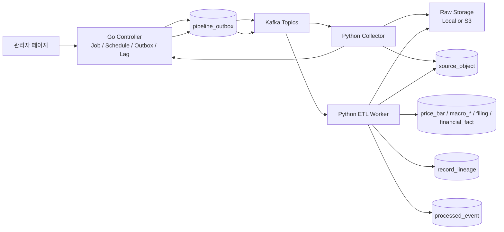
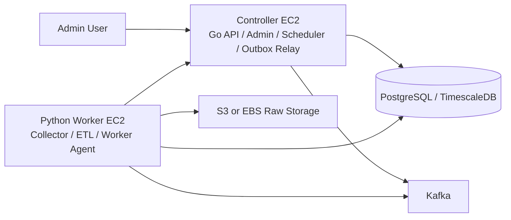

# 파이프라인 운영 및 장애 복구 설계

## 1. 목적

이 문서는 Trader 데이터 파이프라인을 운영 관점에서 설명하기 위한 기준 문서다.

현재 검증된 범위는 다음과 같다.

- Go 기반 `trader-controller`가 job, schedule, outbox, Kafka relay, lag monitor, worker 상태를 관리한다.
- Python 기반 `trader-data`가 KIS, BLS, SEC 데이터를 수집하고 ETL을 수행한다.
- raw 원본 데이터는 DB에 직접 저장하지 않고 로컬 파일 또는 S3에 저장한다.
- DB에는 raw 위치, 처리 상태, 결과 테이블과의 lineage만 저장한다.
- Kafka는 raw 본문 저장소가 아니라 "처리해야 할 이벤트"를 전달하는 역할을 맡는다.

서비스의 핵심 목표는 미래 예측이 아니라 과거 시점의 데이터, 공개 시각, 시장 반응을 복기하는 것이다. 따라서 장애가 발생해도 원본 데이터와 처리 이력을 잃지 않는 것이 가장 중요하다.

## 2. 현재 검증된 전체 흐름



두 종류의 이벤트가 있다.

| 이벤트 | Topic | 의미 |
| --- | --- | --- |
| `JOB_ITEM_QUEUED` | `trader.jobs.events` | 특정 job item을 실행하라는 제어 이벤트 |
| `RAW_OBJECT_READY` | `trader.raw.*.ready` | raw 원본 저장이 끝났으니 ETL을 수행하라는 데이터 처리 이벤트 |

현재 topic은 다음처럼 분리한다.

| Topic | 담당 worker | 목적 |
| --- | --- | --- |
| `trader.jobs.events` | `kafka_pipeline_consumer` | 기존 job item 실행 |
| `trader.raw.kis.ready` | `kis_price_etl_worker` | KIS 주가 raw ETL |
| `trader.raw.bls.ready` | `bls_macro_etl_worker` | BLS 매크로 raw ETL |
| `trader.raw.sec.ready` | `sec_financial_etl_worker` | SEC 재무 raw ETL |
| `trader.raw.news.ready` | 향후 news ETL worker | 뉴스 raw ETL 확장 예정 |

topic을 나누는 이유는 source마다 처리량, 지연 허용치, 실패 영향 범위가 다르기 때문이다.

- KIS는 종목 수가 많고 일일 반복 수집이 많다. lag 기준을 비교적 크게 둘 수 있다.
- SEC는 companyfacts와 submissions가 무겁다. 야간 또는 저부하 시간대 ETL로 분리할 가치가 크다.
- BLS는 데이터량은 작지만 발표 예정, 제공 불가, 누락 상태가 중요하다.
- 뉴스는 빈도와 중복 가능성이 높으므로 별도 topic으로 격리하는 편이 좋다.

## 3. 검증 완료 상태

2026-07-03 기준으로 KIS, BLS, SEC 모두 다음 공통 흐름이 검증되었다.

```text
collector-only
-> raw 파일 저장
-> source_object 생성 또는 갱신
-> Go controller raw-ready API 호출
-> pipeline_outbox RAW_OBJECT_READY 생성
-> Kafka source별 raw topic 발행
-> etl-only worker 소비
-> 정규화 테이블 upsert
-> record_lineage 저장
-> source_object PROCESSED
-> processed_event SUCCESS
```

| Source | 검증 데이터 | 결과 테이블 | 검증 결과 |
| --- | --- | --- | --- |
| KIS | NVDA, source_object `8755` | `price_bar` | `RAW_OBJECT_READY:8755`, `processed_event SUCCESS`, `price_bar` lineage 4건 |
| BLS | CPI `CUSR0000SA0`, source_object `8756` | `macro_series`, `macro_observation`, `macro_observation_vintage`, `macro_observation_status` | `RAW_OBJECT_READY:8756`, `processed_event SUCCESS`, lineage 총 58건 |
| SEC | AAPL, source_object `459`, `4915` | `company`, `filing`, `financial_fact` | `RAW_OBJECT_READY:4915`, `processed_event SUCCESS`, `financial_fact` lineage 24,852건 |

SEC는 하나의 job item에서 `SUBMISSIONS`, `COMPANY_FACTS` 등 여러 raw 객체가 생길 수 있다. 이때 대표 raw 객체가 `RAW_OBJECT_READY` 이벤트를 만들고, ETL worker는 같은 `pipeline_job_item_id`에 묶인 raw 객체들을 함께 읽어 처리한다.

## 4. 장애 시나리오와 복구 기준

### 4.1 Kafka가 publish 전에 장애

흐름:

```text
Controller or raw-ready API
-> pipeline_outbox(PENDING)
-> Kafka publish 실패
-> RETRY_WAIT
-> Kafka 복구
-> outbox relay 재발행
-> PUBLISHED
```

확인할 테이블:

```sql
SELECT id, event_type, topic, status, attempt_count,
       next_attempt_at, last_error, published_at
FROM pipeline_outbox
ORDER BY id DESC
LIMIT 20;
```

운영 판단:

- `PENDING`: 아직 발행 시도 전이다.
- `RETRY_WAIT`: 발행 실패 후 backoff 대기 중이다.
- `DEAD`: 재시도 한도를 넘었다. 운영자 확인이 필요하다.
- `PUBLISHED`: Kafka partition/offset이 기록된 상태다.

이 구조에서는 Kafka가 잠시 내려가도 job 또는 raw-ready 이벤트가 DB outbox에 남는다. 따라서 Kafka 복구 후 relay가 다시 발행할 수 있다.

### 4.2 Kafka topic이 없거나 잘못된 경우

KIS 검증 중 `trader.raw.kis.ready` topic이 없어서 다음 에러가 발생했다.

```text
Unknown Topic Or Partition
```

복구 흐름:

```text
topic 생성
-> outbox relay 재시도
-> pipeline_outbox.status = PUBLISHED
-> kafka_partition / kafka_offset 기록
```

이 사례는 "인프라 설정 누락이 있어도 이벤트가 유실되지 않고 outbox에 보존된다"는 검증 사례로 사용할 수 있다.

### 4.3 Python ETL worker가 꺼져 있는 경우

Kafka에는 메시지가 쌓이고 consumer lag가 증가한다.

확인할 테이블:

```sql
SELECT topic, consumer_group, total_lag, threshold_lag,
       partition_lags, status, measured_at
FROM kafka_consumer_lag_snapshot
ORDER BY measured_at DESC
LIMIT 20;
```

운영 판단:

- `total_lag = 0`: 소비 지연 없음
- `total_lag > 0`: ETL worker가 늦거나 꺼져 있을 가능성
- `total_lag >= threshold_lag`: 알림 또는 worker scale-out 후보

이 경우 raw 원본은 이미 저장되어 있고 `source_object`도 남아 있으므로 Python worker만 복구하면 ETL을 이어갈 수 있다.

### 4.4 ETL worker가 처리 중 죽은 경우

ETL worker가 Kafka 메시지를 받은 뒤 offset commit 전에 죽으면 Kafka는 같은 메시지를 다시 전달할 수 있다.

중복 처리는 `processed_event`로 막는다.

```sql
SELECT consumer_name, idempotency_key, status,
       topic, partition_no, offset_no, error_message, processed_at
FROM processed_event
ORDER BY processed_at DESC
LIMIT 20;
```

idempotency key 규칙:

| 이벤트 | idempotency key |
| --- | --- |
| `JOB_ITEM_QUEUED` | `JOB_ITEM_QUEUED:{pipeline_job_item_id}` |
| `RAW_OBJECT_READY` | `RAW_OBJECT_READY:{source_object_id}` |

같은 `(consumer_name, idempotency_key)`가 이미 성공했다면 같은 raw 객체를 다시 적재하지 않는다.

### 4.5 ETL 변환 또는 DB 적재 실패

ETL 자체가 실패하면 raw 파일은 유지하고 `source_object.processing_status`를 `FAILED`로 둔다.

확인 쿼리:

```sql
SELECT id, provider, data_type, external_id,
       processing_status, storage_backend, storage_key,
       pipeline_job_item_id, collected_at
FROM source_object
WHERE processing_status = 'FAILED'
ORDER BY collected_at DESC;
```

복구 방식:

- raw 파일을 확인한다.
- transformer 버그 또는 데이터 이상 여부를 판단한다.
- 동일 `source_object_id` 기준으로 ETL worker를 재실행한다.
- 성공하면 `source_object.processing_status = PROCESSED`와 `record_lineage`가 기록된다.

### 4.6 외부 API 장애

Collector 단계에서 외부 API가 실패하면 raw 파일이 없거나 일부만 생길 수 있다.

운영 판단:

- API 장애, rate limit, timeout은 collector retry 대상이다.
- 데이터 제공 불가는 retry보다 `SKIPPED` 또는 availability status로 남기는 것이 좋다.
- BLS처럼 특정 월 데이터가 아직 제공되지 않는 경우는 실패가 아니라 `NOT_AVAILABLE` 성격으로 본다.

### 4.7 raw 데이터 품질 문제

KIS에서 과거에 `close > high` 같은 OHLC 이상값이 있었다.

이 경우 raw 보존이 중요하다.

raw가 없으면 다음을 구분할 수 없다.

- KIS가 잘못 준 값인지
- 우리 파서가 잘못 변환한 것인지
- split, adjustment, currency 처리 문제인지
- 보조 공급원으로 보정해야 하는 값인지

따라서 raw는 S3 또는 로컬에 보존하고, DB에는 다음 연결만 남긴다.

```text
source_object.storage_backend
source_object.storage_key
source_object.content_hash
record_lineage.source_object_id
record_lineage.target_table
record_lineage.target_record_id
```

이 구조 덕분에 차트에서는 이상 데이터를 표시 정책으로 다르게 보여줄 수 있고, 운영자는 raw 원본까지 추적할 수 있다.

## 5. 원격 Python 노드 운영 설계

향후 AWS에서는 서버를 두 개로 나누는 구조가 적합하다.



### 5.1 역할 분리

| 서버 | 역할 |
| --- | --- |
| Controller 서버 | 관리자 API, schedule, job 생성, outbox relay, Kafka health, lag monitor, worker 상태 표시 |
| Python 서버 | KIS/BLS/SEC/뉴스 collector, ETL worker, raw 저장, DB load, lineage 기록 |

Controller가 Python 파일을 직접 실행하는 구조보다, Python 서버에 worker agent를 두고 Controller가 "실행 요청"만 보내는 구조가 안전하다.

### 5.2 권장 방식

1차 권장 구조:

```text
Controller
-> job 생성
-> outbox/Kafka 이벤트 발행
-> Python worker는 Kafka를 소비하며 처리
```

이 방식에서는 Controller가 Python 서버에 매번 SSH로 접속해 명령을 실행하지 않아도 된다. Python worker가 계속 떠 있거나 필요할 때만 켜져 있으면 Kafka backlog를 소비한다.

2차 확장 구조:

```text
Controller
-> Python worker-agent API 호출
-> 특정 worker start/stop/run-once 요청
-> agent가 allowlist에 있는 worker만 실행
```

예시 API:

| API | 의미 |
| --- | --- |
| `GET /healthz` | Python 노드 생존 확인 |
| `GET /workers` | worker별 상태 조회 |
| `POST /workers/{name}/start` | 특정 worker 활성화 요청 |
| `POST /workers/{name}/stop` | 특정 worker 중지 요청 |
| `POST /workers/{name}/run-once` | worker 1회 실행 요청 |
| `GET /metrics` | 처리량, 실패 수, lag 보조 지표 조회 |

중요한 점은 관리자 페이지에서 임의 shell command를 실행하지 않는 것이다. 실행 가능한 worker 이름과 인자는 allowlist로 제한한다.

### 5.3 AWS에서 가능한 실행 방식

| 방식 | 설명 | 장점 | 단점 |
| --- | --- | --- | --- |
| Kafka 상시 소비 | Python worker가 계속 떠서 topic을 소비 | 구조 단순, 장애 복구 쉬움 | 작은 비용이 계속 발생 |
| worker-agent API | Controller가 Python 노드에 start/stop/run-once 요청 | 관리자 페이지에서 제어 가능 | 사설 API 보안 필요 |
| AWS SSM RunCommand | Controller가 SSM으로 Python 서버의 systemd service 실행 | SSH 불필요, IAM 감사 가능 | 느리고 AWS 의존성 증가 |
| k3s Job/CronJob | Controller가 Kubernetes Job을 생성 | 선언적, 재시작 정책 명확 | 초기 도입 비용 있음 |

현재 단계에서는 `Kafka 상시 소비 + worker-agent API 설계`가 가장 적합하다. k3s는 이후 경량 운영 검증으로 붙이는 편이 낫다.

## 6. 원격 실행 상태 모델 제안

원격 Python 노드까지 운영하려면 다음 테이블을 추가할 수 있다. 지금 당장 필수 구현은 아니고, 운영 관리자 페이지를 확장할 때 기준으로 삼는다.

### pipeline_worker_node

Python worker 서버 자체를 나타낸다.

| 필드 | 의미 |
| --- | --- |
| `id` | 내부 노드 ID |
| `node_name` | `python-worker-1` 같은 노드 이름 |
| `private_ip` | Controller가 접근할 private IP |
| `role` | `COLLECTOR_ETL`, `ETL_ONLY` 등 |
| `status` | `ONLINE`, `OFFLINE`, `DRAINING`, `UNKNOWN` |
| `last_heartbeat_at` | 마지막 heartbeat 시각 |
| `capacity_hint` | 처리 가능 worker 또는 간단한 용량 정보 |

### pipeline_worker_process

노드 위에서 도는 worker 프로세스를 나타낸다.

| 필드 | 의미 |
| --- | --- |
| `node_id` | 어느 worker node에서 도는지 |
| `worker_name` | `kis_price_collector`, `sec_financial_etl_worker` 등 |
| `desired_state` | Controller가 원하는 상태. `RUNNING`, `STOPPED` |
| `runtime_state` | 실제 상태. `RUNNING`, `STOPPED`, `FAILED`, `STARTING` |
| `last_started_at` | 마지막 시작 시각 |
| `last_stopped_at` | 마지막 종료 시각 |
| `last_error` | 최근 오류 |

### pipeline_remote_command

Controller가 Python worker-agent에 보낸 명령 이력을 남긴다.

| 필드 | 의미 |
| --- | --- |
| `command_type` | `START_WORKER`, `STOP_WORKER`, `RUN_ONCE` |
| `target_node_id` | 대상 Python 노드 |
| `worker_name` | 대상 worker |
| `payload` | 실행 인자 |
| `status` | `REQUESTED`, `SENT`, `SUCCEEDED`, `FAILED`, `TIMED_OUT` |
| `requested_at` | 요청 시각 |
| `completed_at` | 완료 시각 |
| `error_message` | 실패 사유 |

이 상태 모델을 두면 관리자 페이지에서 "요청만 보낸 상태"와 "실제로 worker가 실행 중인 상태"를 구분할 수 있다.

## 7. 운영 기준

### 7.1 Controller가 보는 지표

| 지표 | 출처 | 의미 |
| --- | --- | --- |
| Outbox pending/dead 수 | `pipeline_outbox` | Kafka 발행 장애 여부 |
| Consumer lag | `kafka_consumer_lag_snapshot` | ETL worker 처리 지연 |
| Worker heartbeat | worker-agent 또는 DB heartbeat | Python 노드 생존 여부 |
| Job/item 상태 | `pipeline_job`, `pipeline_job_item` | 수집 요청 진행 상태 |
| Raw 처리 상태 | `source_object.processing_status` | raw ETL 완료 여부 |
| Consumer 결과 | `processed_event` | Kafka 메시지 소비 성공/실패 |
| Lineage 수 | `record_lineage` | raw와 결과 테이블 연결 여부 |

### 7.2 source별 lag 기준 초안

초기 운영에서는 실제 수치를 보면서 조정한다.

| Topic | 초기 threshold | 이유 |
| --- | ---: | --- |
| `trader.jobs.events` | 100 | job 실행 제어 이벤트라 오래 밀리면 관리자 UX에 바로 영향 |
| `trader.raw.kis.ready` | 1,000 | 종목 수가 많고 batch ETL로 처리 가능 |
| `trader.raw.bls.ready` | 10 | 데이터량이 작아 lag가 크면 worker 장애 가능성이 높음 |
| `trader.raw.sec.ready` | 100 | 파일이 무겁고 처리 시간이 길 수 있어 KIS보다 낮게 시작 |
| `trader.raw.news.ready` | 5,000 | 뉴스는 빈도와 중복이 높을 수 있어 별도 조정 필요 |

## 8. 포트폴리오 관점에서의 의미

이 구조는 단순히 Kafka를 붙인 것이 아니라 다음 문제를 해결한다.

- 수집과 ETL을 분리해 외부 API 지연이 DB 적재 작업을 붙잡지 않게 했다.
- raw 원본을 보존해 이상 데이터 발생 시 원인 분석이 가능하게 했다.
- outbox 패턴으로 Kafka 장애 시 이벤트 유실 가능성을 줄였다.
- processed_event와 idempotency key로 중복 소비를 방어했다.
- source별 topic과 lag 기준으로 장애 전파 범위를 분리했다.
- 관리자 페이지에서 job, outbox, lag, worker 상태를 관측할 수 있는 기반을 만들었다.
- 향후 Python worker node를 별도 서버로 분리해 비용, 부하, 복구 정책을 독립적으로 운영할 수 있다.

지원 직무 관점에서는 다음과 연결된다.

| 직무 방향 | 연결 포인트 |
| --- | --- |
| 디지털트윈 서비스 개발 | 외부 데이터 수집, 상태 동기화, raw와 정규화 데이터 추적, 운영자 화면 |
| 차량 및 로봇관제 자체 플랫폼 개발 | 관제 대상의 상태 수집, 이벤트 기반 처리, worker 상태 제어, 장애 복구 흐름 |
| 플랫폼/SRE | outbox, retry, lag monitor, idempotency, lineage, worker orchestration, 장애 시나리오 문서화 |

핵심 어필 문장은 다음처럼 정리할 수 있다.

```text
외부 API 수집과 DB 적재를 분리하고, raw 원본을 S3/로컬에 보존한 뒤 source_object와 record_lineage로 결과 데이터까지 추적되도록 설계했습니다. Kafka 장애 시에는 outbox에 이벤트를 보존하고, worker 장애 시에는 consumer lag와 processed_event를 기준으로 재처리 가능성을 확인했습니다. 이를 관리자 페이지에서 운영자가 볼 수 있도록 구성해 데이터 파이프라인의 장애 지점과 복구 경로를 명확히 했습니다.
```

## 9. 다음 구현 순서

오늘 이후 구현 우선순위는 다음이 적합하다.

1. Python worker-agent 설계 확정
2. Controller에 worker node 상태 조회 API 추가
3. Python worker-agent에 `/healthz`, `/workers`, `/workers/{name}/run-once` 추가
4. 관리자 페이지에 Python node 상태와 worker start/stop 요청 버튼 추가
5. AWS 배포 시 Controller EC2와 Python Worker EC2를 분리하고 private network로 연결
6. 필요 시 SSM RunCommand 또는 k3s Job 방식으로 원격 실행 방식을 확장

중요한 순서는 "원격으로 아무 파일이나 실행"이 아니라 "허용된 worker를 상태 기반으로 실행"하는 것이다. 그래야 운영 자동화 경험으로 설명하기 쉽고, 장애 상황에서도 무엇이 요청되었고 실제로 무엇이 실행되었는지 추적할 수 있다.
