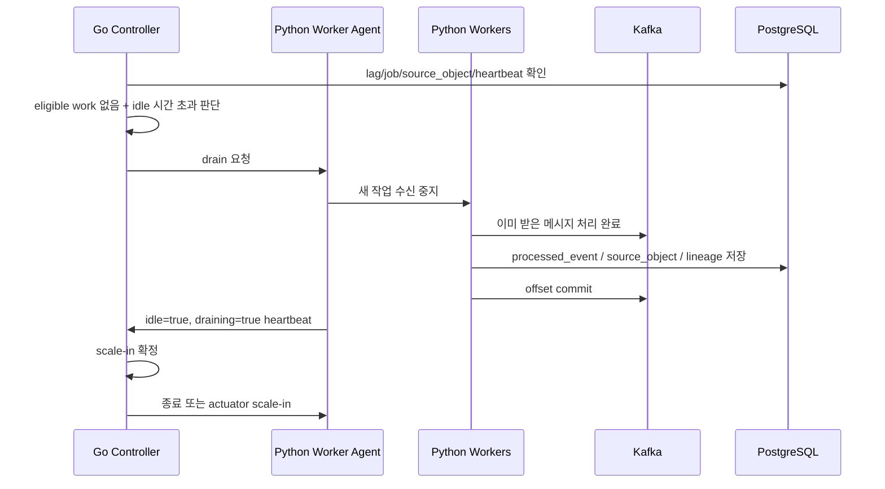

# 워커 시작 종료 정책 설계

## 1. 목적

이 문서는 `trader-controller`와 `trader-data` Python worker node 사이에서 worker를 언제 켜고, 언제 멈추고, 어떤 기준으로 graceful down할지 정리하기 위한 설계 문서다.

핵심 목표는 다음과 같다.

- 수집/ETL 작업을 실시간으로 항상 처리하지 않고 비용 효율적으로 실행한다.
- Kafka lag, job backlog, schedule, source별 정책을 기준으로 Python worker node를 가동한다.
- 처리 가능한 작업이 없고 idle 시간이 충분히 지난 경우 Python worker node를 graceful down한다.
- 정책은 Python 코드에 하드코딩하지 않고 Go Controller와 DB를 기준으로 관리한다.
- Python worker는 실행 주체이고, Controller는 운영 판단과 capacity 제어 주체로 분리한다.

## 2. 역할 분리

```text
Go Controller
= 정책의 source of truth
= job/schedule/outbox/lag/worker 상태 관측
= Docker 또는 ASG actuator로 worker node capacity 조절

Python Worker Agent
= Python 컨테이너 내부의 worker supervisor
= 정책을 조회하고 worker process start/stop
= heartbeat와 처리 상태 보고
= Kafka consume과 실제 collector/ETL 실행
```

정리하면 다음과 같다.

| 구분 | Go Controller | Python Worker Agent |
| --- | --- | --- |
| 노드 실행 여부 판단 | 담당 | 담당하지 않음 |
| ASG/Docker 조작 | 담당 | 담당하지 않음 |
| source별 threshold 관리 | 담당 | 조회만 함 |
| worker process 실행/종료 | 요청 또는 정책 제공 | 실제 실행 |
| Kafka 메시지 처리 | 직접 처리하지 않음 | 담당 |
| raw 저장/ETL | 직접 처리하지 않음 | 담당 |
| heartbeat | 수신/저장 | 전송 |
| graceful down 최종 결정 | 담당 | drain 수행 후 idle 보고 |

## 3. 시작 정책 개념

Python worker node는 다음 조건 중 하나 이상을 만족하면 가동 후보가 된다.

```text
1. Kafka lag가 source별 threshold 이상
2. pipeline_job_item QUEUED 수가 source별 threshold 이상
3. collection_schedule 실행 시각 도달
4. 관리자 페이지에서 수동 실행 요청
5. source_object 중 COLLECTED 상태가 누적되어 ETL 대기 상태
```

중요한 점은 Controller가 "무슨 Python 파일을 직접 실행할지"를 결정하는 것이 아니라, "해당 worker target의 desired capacity를 올릴지"를 결정한다는 것이다.

```text
Controller
-> worker target: python-worker-node
-> desired capacity: 1
-> Local: Docker container start
-> AWS: ASG desired capacity 0 -> 1
```

Python worker node가 뜨면 worker-agent가 정책을 조회하고 필요한 worker process를 실행한다.

```text
Python Worker Agent
-> Controller policy API 조회
-> enabled worker 목록 확인
-> kis_price_etl_worker / bls_macro_etl_worker / sec_financial_etl_worker 실행
-> heartbeat 전송
```

## 4. 종료 정책 개념

종료 조건은 단순히 Kafka lag가 0인지 여부만으로 판단하지 않는다.

더 정확한 기준은 다음이다.

```text
현재 정책상 이 노드가 처리해야 할 eligible work가 없는가?
```

큐에 메시지가 남아 있어도 현재 정책상 처리 대상이 아닐 수 있다.

예를 들어 SEC ETL은 야간 처리 정책을 둘 수 있다.

```text
SEC lag = 300
현재 시각 = 14:00
SEC 허용 시간 = 01:00 ~ 06:00
=> 큐는 있지만 현재 처리 대상은 아님
=> 다른 작업도 없고 idle 시간이 지나면 graceful down 가능
```

종료 후보 조건은 다음과 같다.

```text
1. 현재 시간 기준 eligible work가 없음
2. RUNNING pipeline_job_item이 없음
3. PROCESSING source_object가 없음
4. Python worker heartbeat가 idle=true를 보고
5. idle 상태가 source 또는 target 정책의 scale_in_idle_seconds 이상 지속
6. drain 요청 후 worker가 새 작업 수신을 중단하고 현재 작업을 완료
```

이 조건을 만족하면 Controller가 actuator를 통해 worker node를 종료한다.

```text
Local: Docker container stop
AWS: ASG desired capacity 1 -> 0
```

## 5. Graceful Down 흐름



graceful down의 핵심은 다음이다.

```text
처리 중인 메시지는 끝낸다.
새 메시지는 더 가져오지 않는다.
결과와 offset을 기록한 뒤 종료한다.
```

## 6. Go Controller가 참조할 DB 테이블

### pipeline_job

job 단위의 전체 상태를 본다.

| 컬럼 예시 | 용도 |
| --- | --- |
| `id` | job 식별자 |
| `source` | KIS, BLS, SEC, NEWS |
| `job_type` | 수집/백필/ETL 유형 |
| `status` | QUEUED, RUNNING, SUCCESS, FAILED 등 |
| `parameters` | 실행 파라미터 |
| `created_at`, `completed_at` | 실행 시간 판단 |

사용 목적:

- source별 대기 job 수 확인
- 실행 중인 job 유무 확인
- 관리자 페이지의 job 상태 표시

### pipeline_job_item

실제 worker가 처리하는 item 단위 상태다.

| 컬럼 예시 | 용도 |
| --- | --- |
| `id` | item 식별자 |
| `job_id` | 부모 job |
| `item_key` | `KIS:2872`, `BLS:CUSR0000SA0`, `SEC:AAPL` 등 |
| `status` | QUEUED, RUNNING, COLLECTED, SUCCESS, FAILED, SKIPPED |
| `attempt_count` | 재시도 횟수 |
| `checkpoint` | worker 처리 결과와 중간 상태 |
| `started_at`, `completed_at` | 실행 시간 |

사용 목적:

- source별 `QUEUED` item 수로 scale-out 후보 판단
- `RUNNING` item 존재 여부로 scale-in 차단
- 실패 item 재시도 판단

### pipeline_outbox

Kafka 발행 대기/성공/실패 상태다.

| 컬럼 예시 | 용도 |
| --- | --- |
| `id` | outbox 이벤트 ID |
| `event_type` | `JOB_ITEM_QUEUED`, `RAW_OBJECT_READY` |
| `topic` | 발행 대상 topic |
| `status` | PENDING, PUBLISHING, PUBLISHED, RETRY_WAIT, DEAD |
| `job_item_id` | job item 이벤트 연결 |
| `source_object_id` | raw-ready 이벤트 연결 |
| `kafka_partition`, `kafka_offset` | 발행 성공 위치 |
| `last_error` | 발행 실패 사유 |

사용 목적:

- Kafka publish 장애 판단
- `PENDING`, `RETRY_WAIT`, `DEAD` 수로 운영 알림
- raw-ready 이벤트가 Kafka에 정상 발행됐는지 확인

### kafka_consumer_lag_snapshot

topic별 consumer lag 측정 결과다.

| 컬럼 예시 | 용도 |
| --- | --- |
| `topic` | Kafka topic |
| `consumer_group` | consumer group |
| `total_lag` | 전체 lag |
| `threshold_lag` | 알림 기준 |
| `partition_lags` | partition별 lag JSON |
| `status` | OK, WARN, CRITICAL 등 |
| `measured_at` | 측정 시각 |

사용 목적:

- source별 scale-out 기준
- worker 처리 지연 감지
- topic별 임계치 조정 근거

### source_object

raw 원본 객체의 위치와 처리 상태다.

| 컬럼 예시 | 용도 |
| --- | --- |
| `id` | raw 객체 ID |
| `provider` | KIS, BLS, SEC, NEWS |
| `data_type` | PRICE_BAR, TIMESERIES, COMPANY_FACTS 등 |
| `pipeline_job_item_id` | 어떤 job item에서 생성됐는지 |
| `storage_backend` | LOCAL, S3 |
| `storage_key` | raw 객체의 상대 경로 |
| `object_uri` | 현재 환경에서 접근 가능한 URI |
| `processing_status` | COLLECTED, PROCESSING, PROCESSED, FAILED |
| `content_hash` | raw 내용 해시 |

사용 목적:

- ETL 대기 raw 수 확인
- `PROCESSING` 상태가 남아 있으면 scale-in 차단
- raw-ready 이벤트 재발행 또는 ETL 재처리 기준

### processed_event

Kafka consumer의 처리 결과와 중복 처리 방지 이력이다.

| 컬럼 예시 | 용도 |
| --- | --- |
| `consumer_name` | 어떤 worker가 처리했는지 |
| `idempotency_key` | 중복 방지 키 |
| `status` | SUCCESS, FAILED, SKIPPED |
| `topic`, `partition_no`, `offset_no` | Kafka 위치 |
| `error_message` | 처리 실패 사유 |
| `processed_at` | 처리 시각 |

사용 목적:

- Kafka 메시지 소비 성공/실패 확인
- 중복 이벤트 skip 근거
- worker 실패율 계측

### record_lineage

raw 객체와 정규화 결과 테이블의 연결이다.

| 컬럼 예시 | 용도 |
| --- | --- |
| `source_object_id` | 원본 raw 객체 |
| `target_table` | 결과 테이블 |
| `target_record_id` | 결과 row ID |
| `target_record_key` | 결과 row 고유 키 |
| `transformer_name` | 변환 worker |
| `transformer_version` | 변환 버전 |
| `processed_at` | 변환 시각 |

사용 목적:

- raw 원본에서 결과 데이터까지 추적
- ETL 성공 여부 검증
- 이상 데이터 발생 시 원인 분석

## 7. 추가 제안 DB 테이블

다음 테이블은 아직 상세 구현 전 단계의 제안이다. worker node 운영과 정책을 DB 기준으로 관리하려면 추가하는 것이 좋다.

### worker_target

Controller가 scale 대상으로 보는 논리적 worker node다.

| 컬럼 | 의미 |
| --- | --- |
| `id` | 내부 ID |
| `target_key` | `python-worker-node`, `sec-worker-node` 등 |
| `environment` | LOCAL, AWS |
| `driver` | LOCAL_DOCKER, AWS_ASG |
| `display_name` | 관리자 페이지 표시 이름 |
| `enabled` | scale 제어 활성화 여부 |
| `min_capacity` | 최소 capacity |
| `max_capacity` | 최대 capacity |
| `scale_in_idle_seconds` | 종료 전 idle 유지 시간 |
| `config_json` | Docker service명, ASG name 등 |

예시 `config_json`:

```json
{
  "composeProject": "trader",
  "composeFile": "docker-compose.local-worker.yml",
  "serviceName": "trader-python-worker"
}
```

AWS 예시:

```json
{
  "region": "ap-northeast-2",
  "asgName": "trader-python-worker-asg"
}
```

### worker_policy

source 또는 worker별 실행 정책이다.

| 컬럼 | 의미 |
| --- | --- |
| `id` | 내부 ID |
| `policy_key` | `kis-etl-policy` 등 |
| `source` | KIS, BLS, SEC, NEWS |
| `worker_name` | 실행할 Python worker 이름 |
| `enabled` | 정책 활성화 여부 |
| `mode` | ALWAYS_ON, ON_DEMAND, SCHEDULED |
| `scale_out_lag_threshold` | scale-out lag 기준 |
| `scale_out_queue_threshold` | queued item 기준 |
| `scale_in_idle_seconds` | source별 idle 종료 기준 |
| `allowed_start_time` | 처리 허용 시작 시각 |
| `allowed_end_time` | 처리 허용 종료 시각 |
| `max_concurrency` | worker 병렬성 |
| `poll_interval_seconds` | agent 정책 refresh 또는 worker poll 간격 |
| `config_json` | source별 추가 옵션 |

예시:

```json
{
  "source": "SEC",
  "worker_name": "sec_financial_etl_worker",
  "mode": "SCHEDULED",
  "scale_out_lag_threshold": 100,
  "scale_in_idle_seconds": 1800,
  "allowed_start_time": "01:00",
  "allowed_end_time": "06:00",
  "max_concurrency": 1
}
```

### worker_node_heartbeat

Python worker node가 주기적으로 보고하는 현재 상태다.

| 컬럼 | 의미 |
| --- | --- |
| `node_id` | worker node ID |
| `node_name` | `python-worker-1` 등 |
| `target_key` | 어느 worker target에 속하는지 |
| `status` | ONLINE, DRAINING, IDLE, UNKNOWN |
| `idle` | 현재 처리할 작업이 없는지 |
| `accepting_new_work` | 새 작업 수신 여부 |
| `running_workers` | 실행 중 worker 목록 JSON |
| `running_job_items` | 실행 중 job item 수 |
| `processing_source_objects` | PROCESSING raw 수 |
| `last_heartbeat_at` | 마지막 heartbeat 시각 |
| `metadata_json` | host, image version, pid 등 |

사용 목적:

- scale-in 전에 worker가 실제 idle인지 확인
- worker가 죽었는지 확인
- 관리자 페이지에서 Python node 상태 표시

### worker_scale_command

Controller가 worker target을 켜거나 끄려고 한 명령 이력이다.

| 컬럼 | 의미 |
| --- | --- |
| `id` | 명령 ID |
| `target_key` | 대상 worker target |
| `requested_capacity` | 요청 capacity |
| `previous_capacity` | 이전 capacity |
| `reason` | LAG_EXCEEDED, MANUAL, IDLE_TIMEOUT 등 |
| `status` | REQUESTED, RUNNING, SUCCEEDED, FAILED, SKIPPED |
| `requested_at` | 요청 시각 |
| `completed_at` | 완료 시각 |
| `error_message` | 실패 사유 |

사용 목적:

- 누가 왜 worker node를 켰는지 추적
- ASG/Docker 조작 실패 확인
- 운영 자동화 이력 문서화

### worker_remote_command

Controller가 Python worker-agent에 보낸 프로세스 단위 명령 이력이다.

| 컬럼 | 의미 |
| --- | --- |
| `id` | 명령 ID |
| `node_name` | 대상 Python node |
| `worker_name` | 대상 worker |
| `command_type` | START_WORKER, STOP_WORKER, RUN_ONCE, DRAIN |
| `payload` | 실행 옵션 |
| `status` | REQUESTED, SENT, SUCCEEDED, FAILED, TIMED_OUT |
| `requested_at` | 요청 시각 |
| `completed_at` | 완료 시각 |
| `error_message` | 실패 사유 |

사용 목적:

- 관리자 페이지에서 worker process start/stop 요청 추적
- "요청됨"과 "실제 실행됨" 상태 구분
- 임의 shell 실행 대신 allowlist 기반 명령만 허용

## 8. 정책 API 초안

Python worker-agent는 부팅 시점과 주기적 refresh 시점에 Controller에서 정책을 조회한다.

```http
GET /api/v1/worker-agent/policies?targetKey=python-worker-node
```

응답 예시:

```json
{
  "targetKey": "python-worker-node",
  "refreshIntervalSeconds": 300,
  "workers": [
    {
      "name": "kis_price_etl_worker",
      "source": "KIS",
      "enabled": true,
      "mode": "ON_DEMAND",
      "topic": "trader.raw.kis.ready",
      "consumerGroup": "trader-data-kis-etl",
      "maxConcurrency": 2,
      "pollIntervalSeconds": 5
    },
    {
      "name": "sec_financial_etl_worker",
      "source": "SEC",
      "enabled": true,
      "mode": "SCHEDULED",
      "topic": "trader.raw.sec.ready",
      "consumerGroup": "trader-data-sec-etl",
      "allowedStartTime": "01:00",
      "allowedEndTime": "06:00",
      "maxConcurrency": 1
    }
  ]
}
```

정책 변경 반영 흐름:

```text
Python Worker Agent
-> 5~10분마다 policy 조회
-> disabled worker는 drain 후 stop
-> enabled worker는 필요 시 start
-> concurrency, poll interval 등 반영
-> heartbeat로 현재 상태 보고
```

## 9. Heartbeat API 초안

Python worker-agent는 주기적으로 Controller에 상태를 보고한다.

```http
POST /api/v1/worker-agent/heartbeat
```

요청 예시:

```json
{
  "nodeName": "python-worker-1",
  "targetKey": "python-worker-node",
  "status": "RUNNING",
  "idle": false,
  "acceptingNewWork": true,
  "runningWorkers": [
    {
      "name": "kis_price_etl_worker",
      "state": "RUNNING",
      "currentItem": null
    }
  ],
  "runningJobItems": 0,
  "processingSourceObjects": 1,
  "metadata": {
    "imageVersion": "trader-data-worker:local",
    "host": "python-worker-1"
  }
}
```

Controller는 이 heartbeat를 scale-in 판단에 사용한다.

## 10. Drain API 초안

Controller가 worker node 종료 전 Python worker-agent에 drain을 요청한다.

```http
POST /api/v1/worker-agent/drain
```

또는 특정 node 기준:

```http
POST /api/v1/worker-nodes/{nodeName}/drain
```

Python agent는 drain 요청을 받으면 다음을 수행한다.

```text
1. acceptingNewWork=false
2. 새 Kafka poll 중지
3. 이미 받은 메시지 처리 완료
4. DB transaction 완료
5. processed_event 기록
6. Kafka offset commit
7. heartbeat에 status=DRAINING 또는 IDLE 보고
```

Controller는 heartbeat에서 다음 조건을 확인한 후 scale-in한다.

```text
idle = true
acceptingNewWork = false
runningJobItems = 0
processingSourceObjects = 0
```

## 11. Source별 정책 포맷

상세 수치는 이후 실제 운영 데이터를 보며 조정한다. 우선 포맷은 다음처럼 둔다.

### KIS

| 항목 | 값 |
| --- | --- |
| 처리 방식 | ON_DEMAND 또는 SCHEDULED |
| scale-out 조건 | `trader.raw.kis.ready` lag 기준, KIS job queue 기준 |
| scale-in 조건 | eligible work 없음 + idle 시간 초과 |
| graceful down | 현재 price ETL item 완료 후 종료 |
| 주의점 | 종목 수가 많아 lag threshold를 너무 낮게 두면 노드가 자주 켜질 수 있음 |

### BLS

| 항목 | 값 |
| --- | --- |
| 처리 방식 | ON_DEMAND |
| scale-out 조건 | BLS raw-ready lag 1 이상 또는 발표 schedule 도달 |
| scale-in 조건 | 처리 완료 후 짧은 idle 시간 |
| graceful down | macro ETL 완료 후 종료 |
| 주의점 | 데이터량은 작지만 발표 예정/누락/제공불가 상태 가시성이 중요 |

### SEC

| 항목 | 값 |
| --- | --- |
| 처리 방식 | SCHEDULED 또는 ON_DEMAND |
| scale-out 조건 | SEC job queue, raw-ready lag, 허용 시간대 |
| scale-in 조건 | 허용 시간대 밖이거나 eligible work 없음 + idle 시간 초과 |
| graceful down | 현재 filing/companyfacts 처리 완료 후 종료 |
| 주의점 | companyfacts가 무거우므로 야간 처리와 긴 idle 기준이 적합 |

### NEWS

| 항목 | 값 |
| --- | --- |
| 처리 방식 | ON_DEMAND 또는 ALWAYS_ON |
| scale-out 조건 | news raw-ready lag, 수집량 기준 |
| scale-in 조건 | eligible work 없음 + idle 시간 초과 |
| graceful down | 현재 기사 묶음 처리 완료 후 종료 |
| 주의점 | 중복 제거와 라이선스/원문 보존 정책이 중요 |

## 12. 현재 단계의 결정 사항

현재 단계에서는 다음 원칙을 고정한다.

```text
1. Go Controller가 노드 시작/종료의 최종 판단을 한다.
2. Python Worker Agent는 노드 내부 worker process를 관리한다.
3. 시작/종료 기준은 DB policy로 관리하고 Python 코드에 하드코딩하지 않는다.
4. Python Agent는 부팅 시점과 5~10분 주기로 정책을 조회한다.
5. 큐가 남아 있어도 현재 정책상 eligible work가 없으면 graceful down할 수 있다.
6. 종료 전에는 반드시 drain 상태를 거쳐 처리 중인 메시지를 마무리한다.
7. raw, outbox, processed_event, lineage가 남아 있어야 재처리와 원인 분석이 가능하다.
```

이 설계의 핵심 표현은 다음과 같다.

```text
전체 큐가 비어서 종료한 것이 아니라, 현재 정책 기준으로 처리 가능한 eligible work가 없고 idle 상태가 지속되어 worker node를 graceful down한다. 남은 이벤트는 Kafka와 source_object 상태로 보존되어 다음 허용 시간대에 재처리된다.
```

## 13. Collection Planner / Detector 역할 추가

Python worker node를 최대한 켜지 않기 위해 Go Controller에 가벼운 탐지 역할을 둔다.

이 컴포넌트의 이름은 우선 `Collection Planner` 또는 `Source Change Detector`로 둔다.

중요한 원칙은 다음과 같다.

```text
Go Controller는 외부 데이터를 직접 수집하지 않는다.
Go Controller는 "수집할 필요가 있는지"만 판단한다.
실제 외부 API 호출, raw 저장, ETL은 Python worker가 담당한다.
```

즉 Go Controller가 하는 일은 다음이다.

```text
1. DB에 저장된 최신 수집 상태를 조회한다.
2. source별 정책을 기준으로 수집 필요 여부를 판단한다.
3. 수집할 대상이 있으면 pipeline_job / pipeline_job_item을 생성한다.
4. JOB_ITEM_QUEUED outbox를 생성한다.
5. 필요하면 worker target scale-out을 요청한다.
```

Python worker node는 Go가 만든 job과 Kafka 이벤트를 보고 실제 작업을 수행한다.

```text
Python Worker
-> collector 실행
-> 외부 API 호출
-> raw 파일 저장
-> source_object 생성
-> raw-ready API 호출
-> ETL worker가 RAW_OBJECT_READY 소비
```

이 구조를 두는 이유는 다음과 같다.

- Python worker node는 비용이 더 크므로 불필요하게 켜지 않기 위함이다.
- Go Controller는 이미 상시 떠 있는 경량 control plane이므로 DB 기반 탐지에 적합하다.
- source별 최신성 판단을 중앙화할 수 있다.
- 관리자 페이지에서 "왜 수집 job이 생성되었는지"를 설명하기 쉬워진다.
- AWS에서는 Python worker ASG를 0으로 내려두고 필요할 때만 깨울 수 있다.

## 14. Source별 수집 필요성 탐지 정책

### 14.1 KIS

KIS는 Go가 DB만 보고 수집 필요성을 판단한다.

참조 테이블:

```text
asset
asset_provider_symbol
price_bar
collection_schedule
pipeline_job_item
```

판단 기준:

```text
asset별 최신 price_bar.bar_time 확인
target_date와 비교
latest_bar_time < target_date이면 수집 후보
```

초기 target date 계산은 단순하게 시작한다.

```text
target_date = 현재 날짜 또는 전일
```

거래소 캘린더는 초기 필수로 두지 않는다. 현재 구조에서는 KIS에서 기간 범위로 재조회할 수 있으므로, 누락 가능성이 있으면 최신 bar_time + 1일부터 요청하는 방식으로 보완한다.

Go는 수집 후보 asset을 골라 `KIS_PRICE_BACKFILL` 또는 `KIS_PRICE_INCREMENTAL` job을 만든다.

### 14.2 BLS

BLS도 Go가 DB만 보고 판단한다.

참조 테이블:

```text
macro_series
macro_release
macro_observation
macro_observation_status
collection_schedule
```

판단 기준:

```text
발표 예정 시간이 지났는가?
해당 reference_period observation이 존재하는가?
존재하지 않으면 수집 후보
```

BLS는 데이터량이 작기 때문에 lag가 1 이상이거나 발표 이후 누락이 보이면 즉시 Python worker를 켜도 된다.

### 14.3 SEC

SEC는 초기에는 선택 A인 DB 기반 주기 정책으로 간다.

즉 Go가 SEC 외부 API를 직접 호출하지 않는다.

참조 테이블:

```text
company
asset
filing
financial_fact
company_collection_state 또는 worker_policy.config_json
pipeline_job_item
```

판단 기준:

```text
company별 last_checked_at 확인
last_checked_at + check_interval_hours < now이면 수집 후보
```

SEC는 기업 수가 많고 `companyfacts`가 무거우므로 interval을 넓게 둔다.

초기 정책:

```text
check_interval_hours = 168
```

즉 기본적으로 7일에 한 번 정도 기업별 SEC 최신성 확인 job을 만든다.

나중에 비용이나 최신성 요구가 커지면 다음 단계로 고도화할 수 있다.

```text
Go가 SEC submissions metadata만 가볍게 확인
latest accession number가 DB filing 최신값보다 최신이면 Python collector 기동
```

하지만 현재 MVP에서는 DB 기반 주기 정책만 사용한다.

## 15. Source별 ETL 실행 정책 초안

수집 정책과 ETL 정책은 분리한다.

수집은 외부 API 호출과 raw 저장까지이고, ETL은 이미 저장된 raw를 읽어 정규화 테이블에 적재하는 작업이다.

현재 규모 기준:

```text
KIS: 약 1만 개 asset, raw 단위 많음, ETL은 상대적으로 가벼움
SEC: 약 3천~4천 개 기업, companyfacts가 무겁고 financial_fact row 수가 많음
BLS: 약 10개 내외 macro series, raw와 ETL 모두 가벼움
```

### 15.1 KIS ETL 정책

KIS는 전일 또는 최신 가격 데이터가 들어오면 비교적 빠르게 반영하는 것이 좋다.

다만 실시간 가격 서비스가 아니므로 raw가 1개 생길 때마다 Python worker를 깨우기보다는 일정량을 모아 batch로 처리한다.

초기값:

| 항목 | 값 |
| --- | --- |
| mode | `ON_DEMAND` |
| topic | `trader.raw.kis.ready` |
| scale_out_lag_threshold | `100` |
| scale_out_queue_threshold | `1` |
| batch_size | `300` |
| max_concurrency | `4` |
| scale_in_idle_seconds | `900` |
| allowed_start_time | 없음 |
| allowed_end_time | 없음 |

운영 해석:

```text
KIS raw-ready lag가 100개 이상 쌓이면 Python worker node를 켠다.
ETL worker는 한 번에 약 300개 source_object를 처리 대상으로 삼는다.
내부 worker concurrency는 4부터 시작한다.
lag가 0이고 eligible work가 없으며 15분 idle이면 graceful down한다.
```

KIS는 병렬 처리 여지가 있으나, DB upsert와 lineage insert 부하를 보며 4에서 8 사이로 조정한다.

### 15.2 BLS ETL 정책

BLS는 데이터량이 작기 때문에 즉시 처리해도 부담이 작다.

초기값:

| 항목 | 값 |
| --- | --- |
| mode | `ON_DEMAND` |
| topic | `trader.raw.bls.ready` |
| scale_out_lag_threshold | `1` |
| scale_out_queue_threshold | `1` |
| batch_size | `20` |
| max_concurrency | `1` |
| scale_in_idle_seconds | `300` |
| allowed_start_time | 없음 |
| allowed_end_time | 없음 |

운영 해석:

```text
BLS raw-ready 이벤트가 1개라도 있으면 Python worker를 켤 수 있다.
BLS ETL은 macro_series, macro_observation, macro_observation_vintage, macro_observation_status를 적재한다.
처리 완료 후 5분 idle이면 graceful down한다.
```

BLS는 성능보다 발표 이후 수집 여부, 제공 불가, 누락 상태 가시성이 중요하다.

### 15.3 SEC ETL 정책

SEC는 가장 보수적으로 운영한다.

`companyfacts`와 `submissions` raw가 무겁고, `financial_fact`, `filing`, `record_lineage` 적재량이 크기 때문이다.

초기값:

| 항목 | 값 |
| --- | --- |
| mode | `SCHEDULED` |
| topic | `trader.raw.sec.ready` |
| scale_out_lag_threshold | `10` |
| scale_out_queue_threshold | `1` |
| batch_size | `20` |
| max_concurrency | `1` |
| scale_in_idle_seconds | `1800` |
| allowed_start_time | `01:00` |
| allowed_end_time | `06:00` |
| check_interval_hours | `168` |

운영 해석:

```text
SEC는 기본적으로 01:00~06:00 사이에만 ETL eligible work로 본다.
SEC raw-ready lag가 10개 이상이거나 SEC job queue가 있으면 worker 가동 후보가 된다.
현재 시각이 허용 시간대 밖이면 lag가 남아 있어도 eligible work가 아닌 것으로 본다.
처리 중인 item이 없고 30분 idle이면 graceful down한다.
```

SEC는 초기에 concurrency 1로 시작한다. DB 부하와 처리 시간을 측정한 뒤 필요하면 2까지 올린다.

### 15.4 NEWS ETL 정책

뉴스는 아직 구현 전이므로 포맷만 둔다.

초기값:

| 항목 | 값 |
| --- | --- |
| mode | `ON_DEMAND` |
| topic | `trader.raw.news.ready` |
| scale_out_lag_threshold | `5000` |
| scale_out_queue_threshold | `1` |
| batch_size | `500` |
| max_concurrency | `2` |
| scale_in_idle_seconds | `600` |
| allowed_start_time | 없음 |
| allowed_end_time | 없음 |

뉴스는 중복 제거, 라이선스, 원문 보존, 회사 매칭 품질이 중요하므로 실제 구현 시 별도로 조정한다.

## 16. Collection Planner 실행 결과 저장 테이블

Go가 수집 필요성을 판단한 결과는 단일 테이블에 저장한다.

테이블명은 우선 `collection_planner_run`으로 둔다.

목적:

```text
왜 Python worker를 켰는지 설명하기 위한 운영 이력
왜 수집 job이 생성되지 않았는지 확인하기 위한 skip 이력
source별 탐지 결과를 관리자 페이지에 보여주기 위한 근거
```

제안 컬럼:

| 컬럼 | 의미 |
| --- | --- |
| `id` | 내부 ID |
| `source` | KIS, BLS, SEC, NEWS |
| `planner_type` | PRICE_INCREMENTAL, MACRO_RELEASE_CHECK, SEC_INTERVAL_CHECK 등 |
| `status` | DETECTED, NOOP, JOB_CREATED, SKIPPED, FAILED |
| `detected_count` | 수집이 필요하다고 판단한 후보 수 |
| `planned_count` | 실제 job item으로 만든 수 |
| `skipped_count` | 정책상 제외한 수 |
| `reason` | 탐지 사유 |
| `policy_snapshot` | 판단 당시 worker_policy 요약 JSON |
| `details_json` | source별 상세 정보 JSON |
| `pipeline_job_id` | 생성된 job ID |
| `started_at` | planner 시작 시각 |
| `completed_at` | planner 종료 시각 |
| `error_message` | 실패 사유 |

예시:

```json
{
  "source": "SEC",
  "planner_type": "SEC_INTERVAL_CHECK",
  "status": "JOB_CREATED",
  "detected_count": 120,
  "planned_count": 20,
  "skipped_count": 100,
  "reason": "last_checked_at exceeded 168 hours",
  "pipeline_job_id": 31
}
```

이 테이블은 수집 결과를 저장하는 테이블이 아니다.

```text
수집 결과 = source_object
ETL 결과 = price_bar, macro_*, filing, financial_fact
Planner 판단 결과 = collection_planner_run
```

## 17. 개발 착수 전 확정된 순서

현재 대화 기준으로 다음 순서로 진행한다.

```text
1. 워커 시작/종료 정책 문서 확정
2. Flyway migration 생성
   - worker_target
   - worker_policy
   - worker_node_heartbeat
   - worker_scale_command
   - collection_planner_run
   - 필요 시 worker_remote_command
3. Go Controller model/repository 추가
4. worker policy 조회 API 추가
5. heartbeat 수신 API 추가
6. Collection Planner 골격 추가
7. LocalDockerActuator 구현
8. 관리자 페이지 worker 상태/정책/최근 planner 실행 결과 표시
9. 로컬 Docker 기반 worker start/stop 검증
10. 이후 AWSASGActuator 구현
```

개발은 Local Docker 기준으로 먼저 검증한다.

AWS ASG는 동일한 actuator interface에 구현체만 추가한다.

```text
LocalDockerActuator = docker compose service start/stop
AWSASGActuator = SetDesiredCapacity(asgName, desired)
```

따라서 오늘 개발의 1차 목표는 AWS가 아니라, 로컬에서 Controller가 정책을 보고 Python worker container를 켜고 끄는 흐름을 검증하는 것이다.
